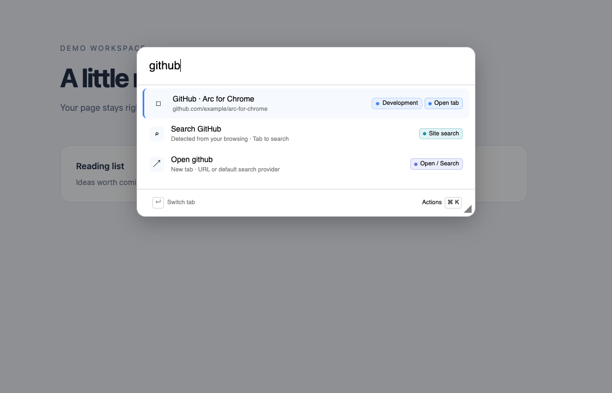

<p align="center">
  
</p>
<h1 align="center">Arc for Chrome</h1>
<p align="center"><strong>Your next tab, one thought away.</strong><br>An Arc-inspired command bar for Google Chrome.</p>
<p align="center">
  <a href="README.md">English</a> · <a href="README.ru.md">Русский</a>
</p>
<p align="center">
  
  
  <a href="LICENSE"></a>
</p>

<p align="center">
  <a href="#see-it-in-action">Demo</a> · <a href="#get-started">Install</a> · <a href="#make-it-muscle-memory">Shortcuts</a> · <a href="#built-for-your-browser">Privacy</a> · <a href="#build-with-us">Contribute</a>
</p>

Find an open tab, revisit a bookmarked page, search a website or run a browser command—without leaving the page in front of you. A small, keyboard-driven overlay brings the parts you need into one place.

**Independent open-source project.** Early MVP; not affiliated with Arc or The Browser Company. The current focus is the command bar. Chrome keeps control of its tabs, pins and browser UI.

## See it in action


*Actual extension interface with fictional browsing data. The loop shows Search → matching open tab → Site Search → Commands. [Static preview](docs/assets/spotlight-light.png) · [How the demo is made](docs/assets/README.md).*

| Find what you already have | Go somewhere new |
| --- | --- |
| **Open tabs first.** Match titles or URLs and switch to the existing tab. | **Search your way.** Ordinary queries use Chrome’s selected search provider. |
| **Bookmarks + history.** Local suggestions bring saved and visited pages together. | **Just the domain.** Open a matched site’s homepage instead of its saved deep link. |
| **Recently closed.** Restore a tab through Chrome’s original browser session. | **Site Search.** Discover search URLs from browsing data and learn the shortcuts you choose. |
| **Forgiving matching.** EN/RU keyboard-layout recovery, accents and small typos. | **Browser actions.** Reload, duplicate, copy the URL, open downloads and more. |

## Get started

**Chrome 116+ · No build step · No account · No external helper**

1. Download this repository using **Code → Download ZIP** and extract it, or clone it.
2. Open `chrome://extensions` and enable **Developer mode**.
3. Click **Load unpacked** and select the repository’s **`extension`** folder.
4. Click the extension’s toolbar icon or press **⌘T** on macOS / **Alt+Shift+K** on Windows and Linux.

Chrome may keep an older key assignment or reject a conflicting binding. Open `chrome://extensions/shortcuts` to check or change it. Modes are available through prefixes and searchable commands; no mode dropdown is needed. The extension is not currently published to the Chrome Web Store.

**Updating:** download/pull the latest files, then click **Reload** on the extension card. If Chrome requests new permissions, review them and re-enable the extension. Reloading the extension uses the files inside `extension`; there is no compiled output to generate.

## Make it muscle memory

| Action | macOS | Windows / Linux |
| --- | --- | --- |
| Open Search | **⌘T** | **Alt+Shift+K** |
| Edit the current URL | **⌘L** | **Alt+Shift+L** |
| Move selected tab left / right | **⌥← / ⌥→** | **Alt+← / Alt+→** |
| Move selected tab to start / end | **⌥⇧← / ⌥⇧→** | **Alt+Shift+← / →** |
| Choose a result | **↑ / ↓** | **↑ / ↓** |
| Open / run the selection | **Enter** | **Enter** |
| Open in a background tab | **Shift+Enter** | **Shift+Enter** |
| Replace the source tab | **⌥Enter** | **Alt+Enter** |
| Force a new foreground tab | **⌘Enter** | **Ctrl+Enter** |
| Exit a mode / close Search | **Esc** | **Esc** |

In Search, Enter activates an existing tab or opens a new one. In **Edit current URL**, Enter replaces the source page; submitting its unchanged URL reloads it. Navigation modifiers apply to URL/search results; commands and session restoration keep their explicit actions.

**Prefixes replace mode controls:** `>` commands · `@` arrange tabs · `<` recently closed · `?` recover AI prompts. For example, `> settings` finds extension/browser settings commands and `> edit current URL` enters address editing without a global shortcut. Backspace on an empty scoped input returns to Search.

**Tab does three useful things:**

- On an empty Search input, enter **Commands**. Typing `>` also opens command mode.
- After a detected site name or abbreviation, enter **Site Search**.
- On a selected URL result, complete its address for editing without navigating.

For ambiguous site matches, choose a site explicitly with the arrows. Repeating the Search shortcut closes the overlay. [Full keyboard guide →](docs/KEYBOARD_REMAPPING.md)

## Search that gets out of your way

### Keep your place

The current page stays open beneath the overlay. Page and video shortcuts are isolated while you type, then focus returns when you dismiss it. On protected pages where Chrome blocks injection, a small separate search window keeps the original tab’s context.

### Let sites find their shortcuts

Search on a website once, then reopen the command bar. If its search URL is recognized in your tabs, recent bookmarks or recent history, the site becomes available as a search scope. Type its name or abbreviation, press **Tab**, enter your query, then **Enter**.

For example, an observed YouTube search can offer **`yt` → Tab → `minimal interface design` → Enter**. Names and aliases depend on the observed data. When you confirm a typed shortcut, the extension saves that association locally and prioritizes it next time.

Settings shows detected sites, lets you clear learned shortcuts and offers optional manual templates for unusual websites. Detection is conservative: it uses a bounded recent sample and recognized query formats; it does not invent endpoints or read Chrome’s internal Site Search settings.

### Shortcut + query, including AI

Type a shortcut, a space and your request, then press Enter—no Tab needed:

| Input | Destination |
| --- | --- |
| `g browser extensions` | Google |
| `ya погода завтра` or `я погода завтра` | Yandex |
| `gpt explain closures` | ChatGPT |
| `gem explain closures` | Gemini |
| `claude review this idea` | Claude |
| `grok explain this topic` | Grok |
| `pplx compare the options` | Perplexity |

These providers are built in. Other exact known/learned site shortcuts work too, for example `yt design` after YouTube is discovered. The top result names the destination; unknown shortcuts remain ordinary searches. Equal-priority shared aliases require choosing a site with ↓. Shortcut + Tab still works. Manual overrides can replace built-in destinations or take ownership of their shortcuts.

AI requests are handed to the provider’s web URL, without API keys, model selection, extra helpers or scripts injected into the chat. Sign-in, prefill and final submission depend on the provider. Claude/Grok web-link behavior and authenticated prompt delivery need installed-profile verification; this is not a guarantee of auto-send.

### Recover a prompt when a page fails

Before opening an AI destination, Spotlight keeps a copy in memory-backed session storage. Type **`?`**, select a request and press Enter to restore it without resending. Only the service shortcut is selected: type another shortcut to redirect the same prompt, or press Enter to retry. **`> Recover AI prompts`** opens the same list; **`> Clear saved AI prompts`** clears it.

Recovery keeps up to 20 prompts, available for 24 hours within the current extension/browser session. Browser restart or extension reload/update/disable clears them. It does not automatically detect failed page loads or replay requests. If a recovery copy cannot be saved, the AI navigation is stopped with an error.

### Your Spotlight activity history

[Preview the history page](docs/assets/spotlight-activity.png).

Open **`> Spotlight activity history`** (or the link in Search settings) to review successful/failed actions, search the journal and change retention. Defaults: **7 days, at most 500 actions**, with query/prompt text excluded. You can disable recording, opt into text recording, choose another age/count limit or clear everything manually. Turning text recording off does not erase older text; clear the history to remove it.

History stays on this device in extension-local storage. A Chrome alarm expires entries while the browser is running; age/count checks also run on activity and when the journal opens. The maximum configurable count is 5,000; zero hours disables age expiry but keeps the count cap. Status reflects Chrome accepting an operation, not whether a website loaded or an AI answered. Recovery prompts remain separate from the journal and its text-recording setting.

### Find the page, or just its homepage

A saved `example.com/articles/some-page` can produce both the original page and an **Open example.com** action. Open tabs in the source window stay first. Shared URLs are merged so the same destination is not repeated across history and bookmarks.

### Search Chrome itself

Type **extensions**, **settings**, **passwords**, **bookmarks** or their Russian names directly in Search. Chrome sections appear with a **Chrome page** label; Enter opens the selected section, and an already open section in the source window is offered as a tab instead. Tab completes its internal address for editing.

The catalogue includes extensions and their shortcuts, browser settings, history, downloads, bookmarks, Password Manager, privacy/security, site permissions, appearance, search engines, languages, accessibility, performance, startup, default browser, autofill, About Chrome, version information and Chrome’s internal-page directory. These destinations also appear in Commands; **Open Chrome settings** is separate from the extension’s **Search settings**.

Known catalogue addresses such as `chrome://extensions` also open directly. Only listed internal routes are recognized; this is navigation to browser pages, not a search inside their private contents or automatic modification of settings. No new permissions are required.

### Put tabs in order

Find an open tab in ordinary Search, select it with ↑/↓ and press **Alt/Option+← or →** to move it immediately. Add **Shift** to move to the start/end instead (**Alt+Home/End** also works). The overlay stays open, refreshes the real order and keeps that tab selected for repeated moves.

Type **`@`** to see tabs in their actual strip order; **`@github`** filters that list. Use the same move keys directly. For an exact destination, press Enter on a tab and choose **Move before…**. That explicit placement closes the overlay after applying; Esc returns to tab selection. Commands → Arrange tabs remains available.

Positions are read from the source window in Chrome’s actual tab-strip order. Start/end stays within the same pinned state and group. Moving before another tab requires the same pinned state and group; a one-position move cannot cross their boundary. This release changes order only, with no automatic regrouping or cross-window moves.

### Use the browser’s appearance

The overlay follows effective light/dark rendering preferences and uses browser-native colors and scalable type. Custom Chrome wallpaper and profile accents are not imported.

<details>
<summary>Light and dark previews</summary>

| Light | Dark |
| --- | --- |
|  |  |

</details>

## Built for your browser

Suggestions are processed locally. There is **no telemetry, backend, online autocomplete or persistent content script**. Typed text is not sent to a completion service. Submitting a web or site search contacts the chosen provider normally, just as opening a link contacts its destination.

| Permission | What it enables |
| --- | --- |
| `tabs` | Read tab titles/URLs, activate tabs and perform requested navigation |
| `activeTab`, `scripting` | Show the overlay when invoked |
| `history`, `bookmarks` | Read local suggestions; never edit or delete these sources |
| `search` | Use Chrome’s chosen default provider |
| `sessions` | List and restore recently closed tabs |
| `storage` | Site templates/aliases, local action history and temporary AI prompt recovery |
| `alarms` | Automatically expire action-history entries |
| `clipboardWrite` | Copy the current URL on request; never read the clipboard |

No permanent host access is requested. Automatically inferred site templates are not persisted; ordinary typed text is not saved while composing. Executed action metadata is stored locally with automatic limits; query/prompt text in that journal is opt-in. AI prompt recovery uses separate temporary session storage. [Security policy →](SECURITY.md)

## What to expect

This is a focused command-bar extension, not a complete Arc replacement. It does not provide a sidebar, Spaces, numbered pins, global MRU cycling or a replacement for Chrome’s native tab strip. Arc ranking and every Arc shortcut are not claimed to match exactly.

Suggestions use bounded local samples, so a very old page or an unusual site search format may not be discovered. Restoring a session follows Chrome’s original session destination and may use another window. Full behavior and edge cases are documented in the [user guide](docs/USER_GUIDE.md).

## Build with us

The extension runs on **Manifest V3 + native JavaScript modules** with no runtime packages. **Node.js 22+** is needed only for development checks.

```sh
npm run check          # Syntax checks + behavior tests
npm run check:browser  # Headless Chrome interaction regression
```

The browser check uses a disposable profile and stubbed Chrome APIs. It exercises the real interface without touching your regular profile. Set `CHROME_BINARY` if Chrome is not at the standard macOS path. Actual installed-extension permissions and browser-service integration have a [manual checklist](docs/TESTING.md).

Bug reports, clear reproduction steps and focused pull requests are welcome. See [Contributing](CONTRIBUTING.md) before making changes.

[User guide](docs/USER_GUIDE.md) · [Architecture](docs/ARCHITECTURE.md) · [Testing](docs/TESTING.md) · [Arc behavior audit](docs/ARC_COMMAND_BAR_AUDIT.md) · [Work log](docs/WORK_LOG.md)

---

[MIT license](LICENSE) · Made for people who miss a good command bar.
