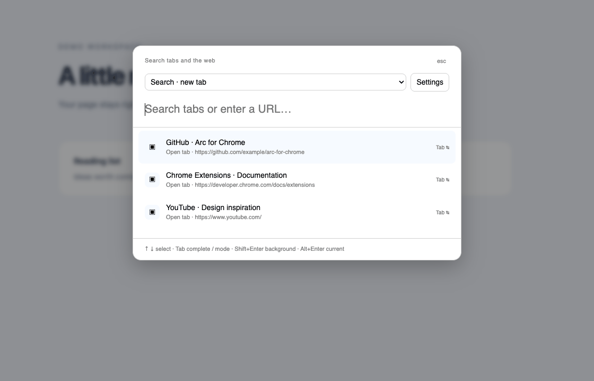
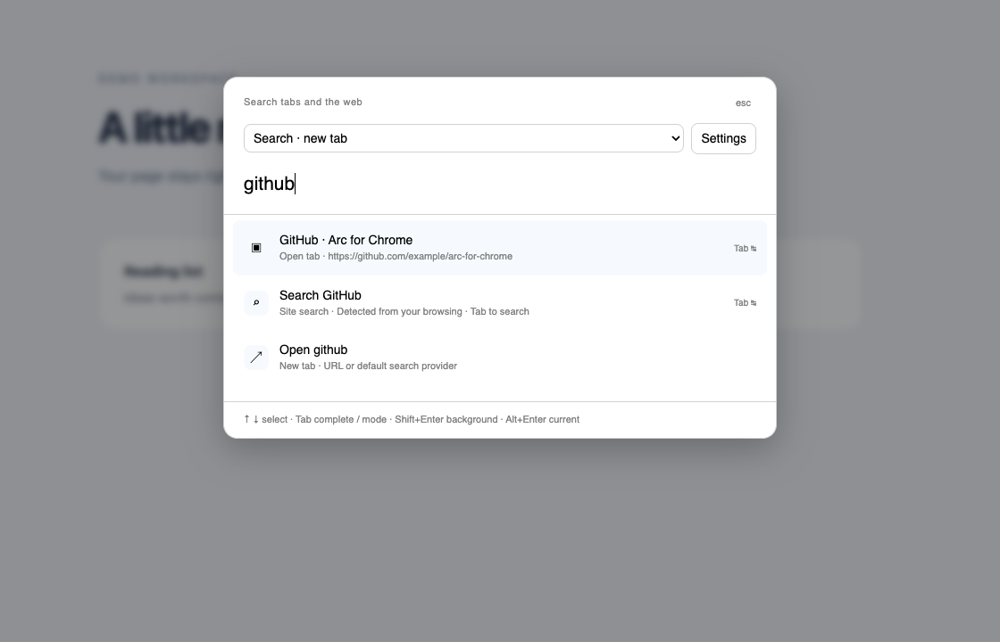
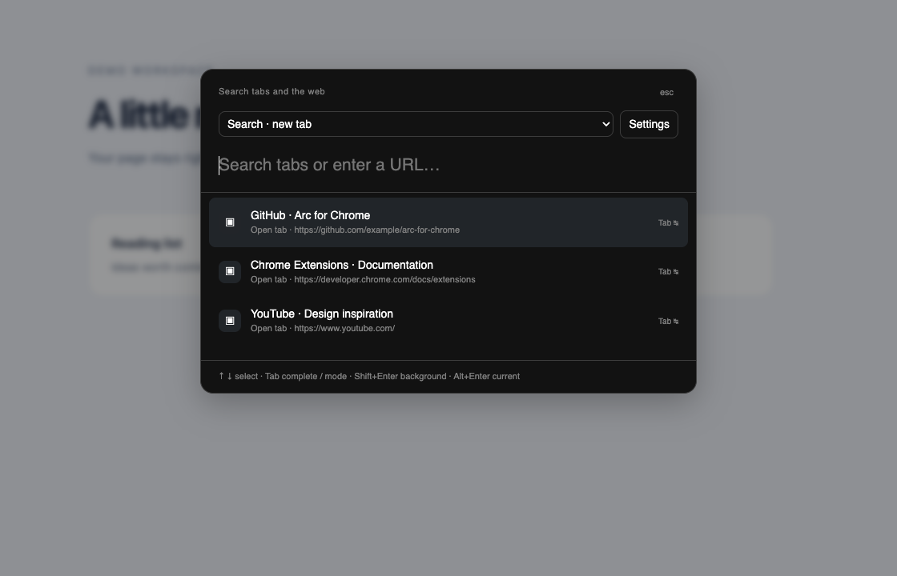

<p align="center">
  
</p>
<h1 align="center">Arc for Chrome</h1>
<p align="center"><strong>Your next tab, one thought away.</strong><br>An Arc-inspired command bar for Google Chrome.</p>
<p align="center">
  <a href="README.md">English</a> · <a href="README.ru.md">Русский</a>
</p>
<p align="center">
  
  
  <a href="LICENSE"></a>
</p>

<p align="center">
  <a href="#see-it-in-action">Demo</a> · <a href="#get-started">Install</a> · <a href="#make-it-muscle-memory">Shortcuts</a> · <a href="#built-for-your-browser">Privacy</a> · <a href="#build-with-us">Contribute</a>
</p>

Find an open tab, revisit a bookmarked page, search a website or run a browser command—without leaving the page in front of you. A small, keyboard-driven overlay brings the parts you need into one place.

**Independent open-source project.** Early MVP; not affiliated with Arc or The Browser Company. The current focus is the command bar. Chrome keeps control of its tabs, pins and browser UI.

## See it in action



*Actual extension interface with fictional browsing data. The loop shows Search → matching open tab → Site Search → Commands. [Static preview](docs/assets/spotlight-light.png) · [How the demo is made](docs/assets/README.md).*

| Find what you already have | Go somewhere new |
| --- | --- |
| **Open tabs first.** Match titles or URLs and switch to the existing tab. | **Search your way.** Ordinary queries use Chrome’s selected search provider. |
| **Bookmarks + history.** Local suggestions bring saved and visited pages together. | **Just the domain.** Open a matched site’s homepage instead of its saved deep link. |
| **Recently closed.** Restore a tab through Chrome’s original browser session. | **Site Search.** Discover search URLs from browsing data and learn the shortcuts you choose. |
| **Forgiving matching.** EN/RU keyboard-layout recovery, accents and small typos. | **Browser actions.** Reload, duplicate, copy the URL, open downloads and more. |

## Get started

**Chrome 116+ · No build step · No account · No external helper**

1. Download this repository using **Code → Download ZIP** and extract it, or clone it.
2. Open `chrome://extensions` and enable **Developer mode**.
3. Click **Load unpacked** and select the repository’s **`extension`** folder.
4. Click the extension’s toolbar icon or press **⌘T** on macOS / **Alt+Shift+K** on Windows and Linux.

Chrome may keep an older key assignment or reject a conflicting binding. Open `chrome://extensions/shortcuts` to check or change it. All modes are also accessible from the overlay’s dropdown. The extension is not currently published to the Chrome Web Store.

**Updating:** download/pull the latest files, then click **Reload** on the extension card. If Chrome requests new permissions, review them and re-enable the extension. Reloading the extension uses the files inside `extension`; there is no compiled output to generate.

## Make it muscle memory

| Action | macOS | Windows / Linux |
| --- | --- | --- |
| Open Search | **⌘T** | **Alt+Shift+K** |
| Edit the current URL | **⌘L** | **Alt+Shift+L** |
| Choose a result | **↑ / ↓** | **↑ / ↓** |
| Open / run the selection | **Enter** | **Enter** |
| Open in a background tab | **Shift+Enter** | **Shift+Enter** |
| Replace the source tab | **⌥Enter** | **Alt+Enter** |
| Force a new foreground tab | **⌘Enter** | **Ctrl+Enter** |
| Exit a mode / close Search | **Esc** | **Esc** |

In Search, Enter activates an existing tab or opens a new one. In **Edit current URL**, Enter replaces the source page; submitting its unchanged URL reloads it. Navigation modifiers apply to URL/search results; commands and session restoration keep their explicit actions.

**Tab does three useful things:**

- On an empty Search input, enter **Commands**. Typing `>` also opens command mode.
- After a detected site name or abbreviation, enter **Site Search**.
- On a selected URL result, complete its address for editing without navigating.

For ambiguous site matches, choose a site explicitly with the arrows. Repeating the Search shortcut closes the overlay. [Full keyboard guide →](docs/KEYBOARD_REMAPPING.md)

## Search that gets out of your way

### Keep your place

The current page stays open beneath the overlay. Page and video shortcuts are isolated while you type, then focus returns when you dismiss it. On protected pages where Chrome blocks injection, a small separate search window keeps the original tab’s context.

### Let sites find their shortcuts

Search on a website once, then reopen the command bar. If its search URL is recognized in your tabs, recent bookmarks or recent history, the site becomes available as a search scope. Type its name or abbreviation, press **Tab**, enter your query, then **Enter**.

For example, an observed YouTube search can offer **`yt` → Tab → `minimal interface design` → Enter**. Names and aliases depend on the observed data. When you confirm a typed shortcut, the extension saves that association locally and prioritizes it next time.

Settings shows detected sites, lets you clear learned shortcuts and offers optional manual templates for unusual websites. Detection is conservative: it uses a bounded recent sample and recognized query formats; it does not invent endpoints or read Chrome’s internal Site Search settings.

### Find the page, or just its homepage

A saved `example.com/articles/some-page` can produce both the original page and an **Open example.com** action. Open tabs in the source window stay first. Shared URLs are merged so the same destination is not repeated across history and bookmarks.

### Use the browser’s appearance

The overlay follows effective light/dark rendering preferences and uses browser-native colors and scalable type. Custom Chrome wallpaper and profile accents are not imported.

<details>
<summary>Light and dark previews</summary>

| Light | Dark |
| --- | --- |
|  |  |

</details>

## Built for your browser

Suggestions are processed locally. There is **no telemetry, backend, online autocomplete or persistent content script**. Typed text is not sent to a completion service. Submitting a web or site search contacts the chosen provider normally, just as opening a link contacts its destination.

| Permission | What it enables |
| --- | --- |
| `tabs` | Read tab titles/URLs, activate tabs and perform requested navigation |
| `activeTab`, `scripting` | Show the overlay when invoked |
| `history`, `bookmarks` | Read local suggestions; never edit or delete these sources |
| `search` | Use Chrome’s chosen default provider |
| `sessions` | List and restore recently closed tabs |
| `storage` | Keep optional site templates and confirmed shortcut associations locally |
| `clipboardWrite` | Copy the current URL on request; never read the clipboard |

No permanent host access is requested. Automatically inferred site templates are not persisted; search text and browsing activity logs are not stored by the extension. [Security policy →](SECURITY.md)

## What to expect

This is a focused command-bar extension, not a complete Arc replacement. It does not provide a sidebar, Spaces, numbered pins, global MRU cycling or a replacement for Chrome’s native tab strip. Arc ranking and every Arc shortcut are not claimed to match exactly.

Suggestions use bounded local samples, so a very old page or an unusual site search format may not be discovered. Restoring a session follows Chrome’s original session destination and may use another window. Full behavior and edge cases are documented in the [user guide](docs/USER_GUIDE.md).

## Build with us

The extension runs on **Manifest V3 + native JavaScript modules** with no runtime packages. **Node.js 22+** is needed only for development checks.

```sh
npm run check          # Syntax checks + behavior tests
npm run check:browser  # Headless Chrome interaction regression
```

The browser check uses a disposable profile and stubbed Chrome APIs. It exercises the real interface without touching your regular profile. Set `CHROME_BINARY` if Chrome is not at the standard macOS path. Actual installed-extension permissions and browser-service integration have a [manual checklist](docs/TESTING.md).

Bug reports, clear reproduction steps and focused pull requests are welcome. See [Contributing](CONTRIBUTING.md) before making changes.

[User guide](docs/USER_GUIDE.md) · [Architecture](docs/ARCHITECTURE.md) · [Testing](docs/TESTING.md) · [Arc behavior audit](docs/ARC_COMMAND_BAR_AUDIT.md) · [Work log](docs/WORK_LOG.md)

---

[MIT license](LICENSE) · Made for people who miss a good command bar.
