<p align="center">
  
</p>
<h1 align="center">Arc for Chrome</h1>
<p align="center"><strong>Your next tab, one thought away.</strong><br>An Arc-inspired command bar for Google Chrome.</p>
<p align="center">
  <a href="README.md">English</a> · <a href="README.ru.md">Русский</a>
</p>
<p align="center">
  
  
  <a href="LICENSE"></a>
</p>

<p align="center">
  <a href="#see-it-in-action">Demo</a> · <a href="#get-started">Install</a> · <a href="#make-it-muscle-memory">Shortcuts</a> · <a href="#built-for-your-browser">Privacy</a> · <a href="#build-with-us">Contribute</a>
</p>

Find an open tab, revisit a bookmarked page, search a website or run a browser command—without leaving the page in front of you. A small, keyboard-driven overlay brings the parts you need into one place.

**Independent open-source project.** Early MVP; not affiliated with Arc or The Browser Company. The current focus is the command bar. Chrome keeps control of its tabs, pins and browser UI.

## See it in action

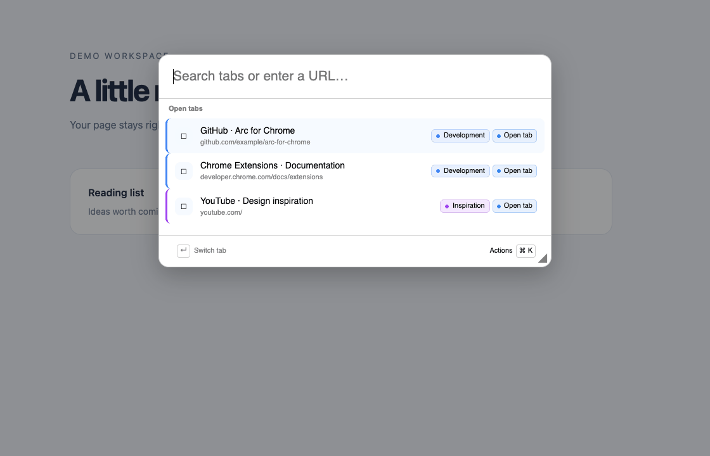

*Actual extension interface with fictional browsing data. The loop shows Search → matching open tab → Site Search → Commands. [Static preview](docs/assets/spotlight-light.png) · [How the demo is made](docs/assets/README.md).*

| Find what you already have | Go somewhere new |
| --- | --- |
| **Open tabs first.** Match titles or URLs and switch to the existing tab. | **Search your way.** Ordinary queries use Chrome’s selected search provider. |
| **Bookmarks + history.** Local suggestions bring saved and visited pages together. | **Just the domain.** Open a matched site’s homepage instead of its saved deep link. |
| **Recently closed.** Restore a tab through Chrome’s original browser session. | **Site Search.** Discover search URLs from browsing data and learn the shortcuts you choose. |
| **Forgiving matching.** EN/RU keyboard-layout recovery, accents and small typos. | **Browser actions.** Reload, duplicate, copy the URL, open downloads and more. |

## Get started

**Chrome 116+ · No build step · No account · No external helper**

1. Download this repository using **Code → Download ZIP** and extract it, or clone it.
2. Open `chrome://extensions` and enable **Developer mode**.
3. Click **Load unpacked** and select the repository’s **`extension`** folder.
4. Click the extension’s toolbar icon or press **⌘T** on macOS / **Alt+Shift+K** on Windows and Linux to open Search over the current page. The extension also provides its Search page when Chrome opens a new tab.

Chrome may preserve an older shortcut assignment after an update. If **⌘T** still opens a regular new tab, check `chrome://extensions/shortcuts` and assign **Open Search** to **⌘T**. Choosing an open tab closes a temporary Search tab.

Chrome may keep an older key assignment or reject a conflicting binding. Open `chrome://extensions/shortcuts` to check or change it. Modes are available through prefixes and searchable commands; no mode dropdown is needed. The extension is not currently published to the Chrome Web Store.

**Updating:** download/pull the latest files, then click **Reload** on the extension card. If Chrome requests new permissions, review them and re-enable the extension. Reloading the extension uses the files inside `extension`; there is no compiled output to generate.

## Make it muscle memory

| Action | macOS | Windows / Linux |
| --- | --- | --- |
| Open Search | **⌘T** | **Alt+Shift+K** |
| Open browser commands | **⌘E** | **Alt+Shift+E** |
| Edit the current URL | **⌘L** | **Alt+Shift+L** |
| Move selected tab left / right | **⌥← / ⌥→** | **Alt+← / Alt+→** |
| Move selected tab to start / end | **⌥⇧← / ⌥⇧→** | **Alt+Shift+← / →** |
| Mark / unmark a tab | **Shift+Space** | **Shift+Space** |
| Create / add to a group | **⌘G** | **Ctrl+G** |
| Remove from groups | **⌘⇧G** | **Ctrl+Shift+G** |
| Manage groups | **⌘⌥G** | **Ctrl+Alt+G** |
| Save in a bookmark folder | **⌘D** | **Ctrl+D** |
| Remove from a bookmark folder | **⌘⇧D** | **Ctrl+Shift+D** |
| Actions for the selected result | **⌘K** | **Ctrl+K** |
| Choose a result | **↑ / ↓** | **↑ / ↓** |
| Open / run the selection | **Enter** | **Enter** |
| Open in a background tab | **Shift+Enter** | **Shift+Enter** |
| Replace the source tab | **⌥Enter** | **Alt+Enter** |
| Force a new foreground tab | **⌘Enter** | **Ctrl+Enter** |
| Exit a mode / close Search | **Esc** | **Esc** |

In Search, Enter activates an existing tab or opens a new one. In **Edit current URL**, Enter replaces the source page; submitting its unchanged URL reloads it. Navigation modifiers apply to URL/search results; commands and session restoration keep their explicit actions.

**Prefixes replace mode controls:** `>` commands · `@` arrange tabs · `<` recently closed · `?` recover AI prompts · `$` quicklinks · `:` notes. For example, `> settings` finds extension/browser settings commands and `> edit current URL` enters address editing without a global shortcut. Backspace on an empty scoped input returns to Search.

These action shortcuts work while Spotlight is open. For vertical tabs, use **Alt/Option+↑/↓**; add Shift for start/end. **`#Work`** chooses a group; **`*Work`** chooses a bookmark folder.

**Commands with destinations.** Type `move to Work` to pick a Chrome tab group or `pin to Work` to pick a bookmark folder, then confirm with Enter. `pin tab` pins the tab itself. Russian equivalents include `переместить в Работа`, `закрепить в Работа` and `закрепить вкладку`. Use `/ ` (slash and space) to open Commands from Search.

**Spaces and layouts.** `New space` creates a Chrome tab group. Type `switch to space Work` to find a group and switch to its most recent open tab. `New Split View` opens a blank second pane, or pairs two marked adjacent tabs in the same group with the same pin state. `Close Split View` separates the panes and keeps both tabs. Split View commands require Chrome 155+. `Open sidebar` opens the searchable tab list. `Manage extensions` opens Chrome's extensions page.

### Quick actions inspired by Arc for Mac

- **Previous tab** jumps to the most recently used tab in the window. The suggested shortcut is **Option+Shift+Q** on Mac and **Alt+Shift+Q** on Windows/Linux.
- **Actions → Copy links from selected tabs** copies marked tabs as URLs. **Copy links as Markdown** includes their titles.
- **Hide this suggestion** removes a history, bookmark or homepage suggestion from Search. **Restore hidden suggestions** resets the list.
- **Paste and go** reads the clipboard only when selected. If Chrome denies access, paste into the field manually. **Open first web result via DuckDuckGo** sends the query on explicit selection.
- Search from a grouped tab scopes open-tab matches to the group. **Switch group / window search** changes the scope. **Route this domain to a group** sends matching web URLs opened by the palette to one uniquely named group in the current window.
- **Open temporary preview** opens a compact window. In that window, **Keep preview as tab** or **Keep preview in Split View** sends the page back to the original window.

**Tab does three useful things:**

- On an empty Search input, enter **Commands**. Typing `>` also opens command mode.
- After a detected site name or abbreviation, enter **Site Search**.
- On a selected URL result, complete its address for editing without navigating.

For ambiguous site matches, choose a site explicitly with the arrows. Repeating the Search shortcut closes the overlay. [Full keyboard guide →](docs/KEYBOARD_REMAPPING.md)

## More from one search field

Results use compact two-line rows: title and address on the left, source/group labels on the right. Chrome's cached site icons load separately without delaying suggestions; missing icons keep a generic symbol. With an empty query, sections surface open tabs, quicklinks, recent activity and frequent commands. Recent activity opens the journal rather than repeating an action. Command frequency comes from the existing bounded journal; with no journal data, starter commands are shown.

### Actions without memorizing shortcuts

Select a result and press **⌘/Ctrl+K**, or click **Actions** in the footer. Search that menu and press Enter. It offers only applicable operations: open/new/background, copy URL or calculation, move/duplicate a tab, group marked tabs, edit folder bookmarks, save/manage a quicklink, or redirect the query. Existing direct hotkeys remain available. **Esc** or the same action shortcut returns to the original query and selection. The footer shows the current primary action with keyboard keycaps; Tab/Shift+Tab reach Actions and the resize handle.

### Keep a query, choose where it goes

Search keeps one web action using your default search provider. For all providers and detected search sites, use **Actions → Search this query with…**, then filter by provider name. The prompt is retained separately from that filter; a recognized leading provider alias is removed when redirecting. Esc returns to the original query. Nothing is submitted until Enter. AI routes retain the existing recovery copy before navigation.

### Named quicklinks

Select a web page → **Actions → Save as quicklink…** → enter a name → Enter. Find it by name or URL in ordinary Search, or type **`$`** / **`$work`** to browse/filter quicklinks. **Manage quicklinks** is also a searchable command. Use Actions on a quicklink to rename or remove it. Saving the current page is available through **Save selected page as quicklink** in Commands.

Quicklinks are local to this Chrome profile, separate from native bookmarks: at most **100**, names **1–80 characters**, HTTP(S) addresses without embedded credentials. They persist until explicitly removed; clearing the action journal does not delete them. They are not automatically synced.

### Notes and the full shortcut map

Open **⌘/Ctrl+K → New note**. Enter a title, Tab to the multiline body, and **⌘/Ctrl+Enter** or **Save note** to save locally. Plain Enter in the body adds a line. Find notes by title or text in Search, **`:query`**, or **Actions → Search / manage notes**. On a note, Actions offers edit, copy text and delete. Esc cancels unsaved edits; reopening a saved note restores its saved text. There is no autosave. Limits: **200 notes**, **80-character titles**, **20,000-character bodies**. Notes are local to this profile, separate from journal retention and without automatic sync. Concurrent edits are revision-checked: a stale editor cannot silently overwrite a newer note; a save failure leaves its text intact. Note text is never included in the action journal.

The same **⌘/Ctrl+K** menu now includes **every extension shortcut and prefix**, including marking, both tab axes/edges, groups/bookmarks, completion/focus, overlay positioning/resizing and note-save. Context actions execute normally; rows labelled **Shortcut** are a reference, explain the required scope, and **Enter copies their instructions**. **All keyboard shortcuts** opens the full searchable directory. Global Search/Edit rows show their actual Chrome assignments, including changed or unassigned bindings; an unavailable lookup says to check Chrome shortcuts rather than guessing. Notes and help remain available when Search has no matching result.

| Multiline notes | All keyboard shortcuts |
| --- | --- |
| 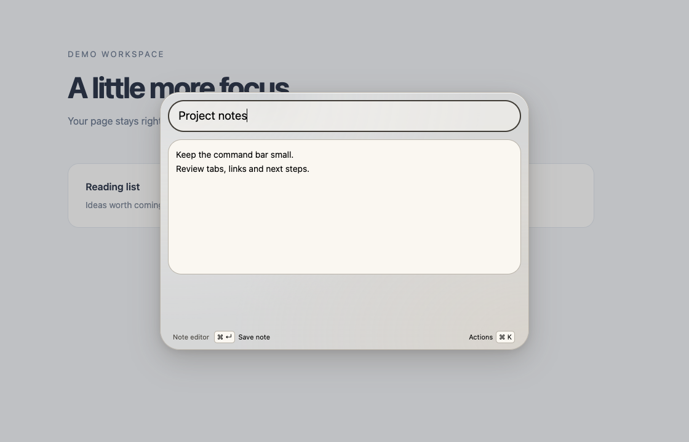 | 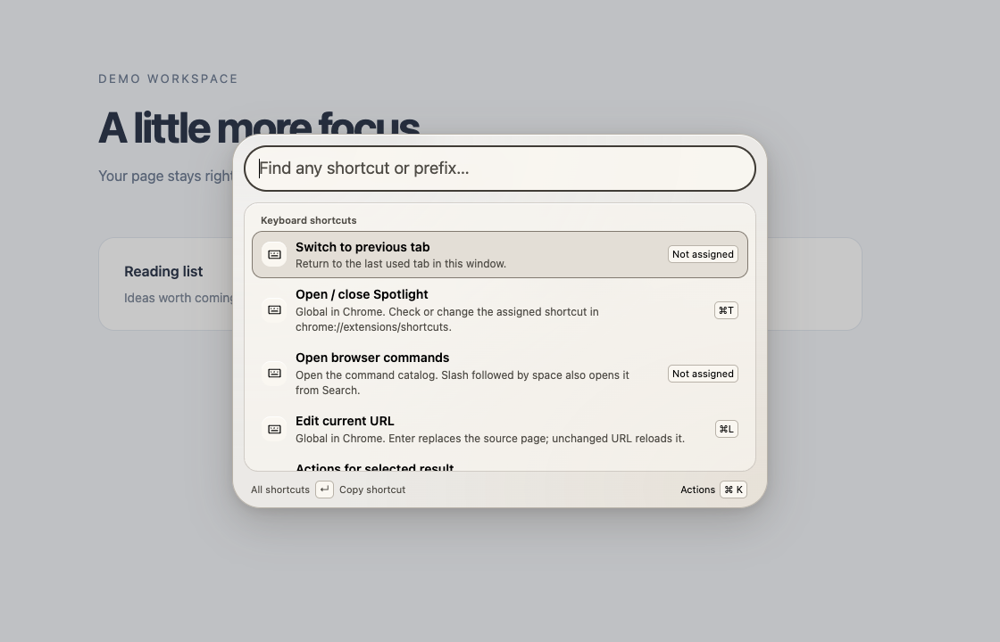 |

[Notes list preview](docs/assets/spotlight-notes.png). All media use fictional notes and shortcut assignments.

### Calculate without leaving the page

Type **`1250 * 0.18`** → **225** → Enter copies the result and keeps Spotlight open. Supports parentheses, `+ - * / ^ %`, unary signs and `× ÷ −`; `%` is remainder. Powers associate right-to-left. Calculations use a bounded local parser without `eval`, round to 12 significant digits and do not provide currency/date/unit conversion. Invalid or non-finite expressions stay ordinary search input. No calculator history is stored.

| Contextual actions | Choose a provider |
| --- | --- |
| 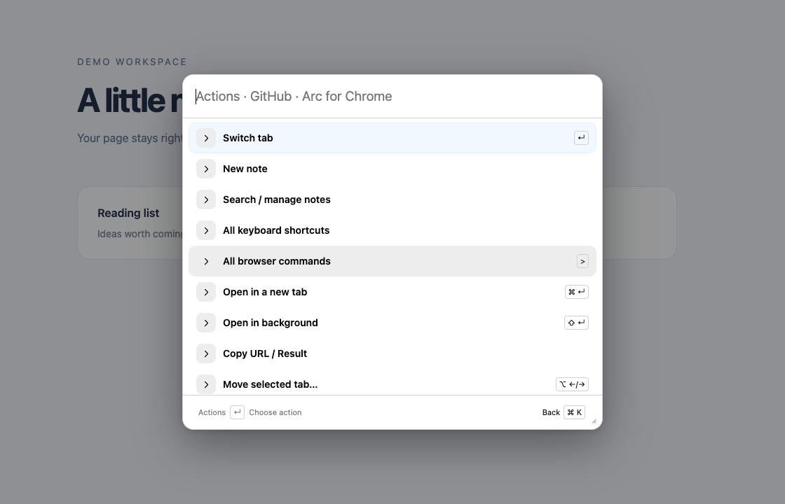 | 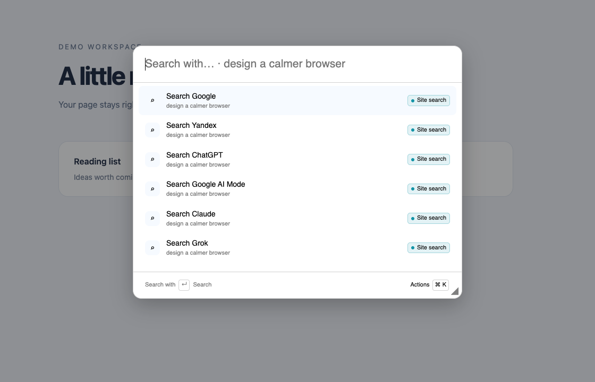 |

| Local calculator | Named quicklinks |
| --- | --- |
| 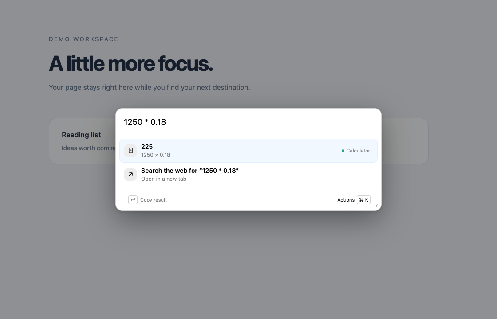 | 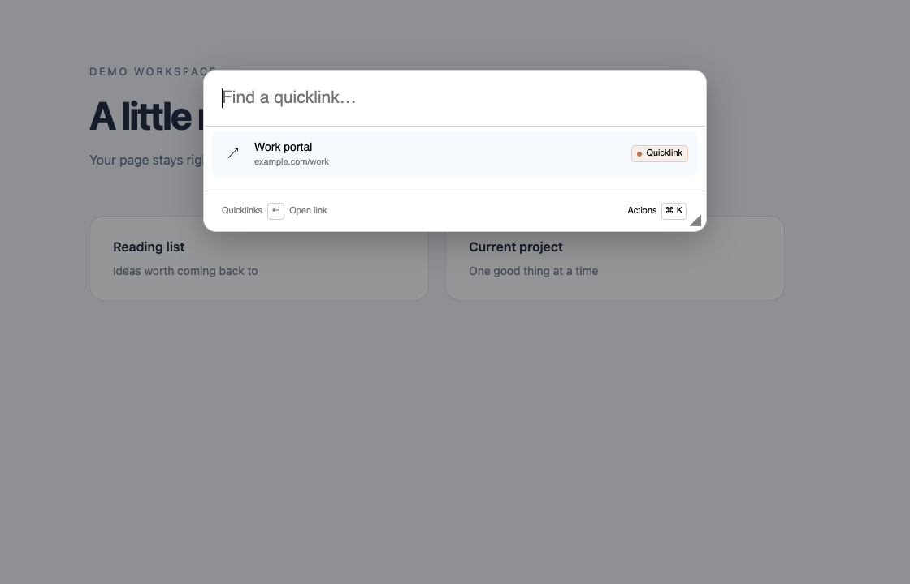 |

## Search that gets out of your way

### Position the overlay

Drag the bottom hint strip to move Spotlight within the browser viewport. **Ctrl+Alt+arrow keys** move it by 16 pixels; add **Shift** for 64-pixel steps. **Ctrl+Alt+0** resets its position. These keys act only while Spotlight is open; Option/Alt+Left/Right still rearranges tabs. Position remains visible as results or window size change and resets on the next open. On protected pages, positioning stays inside the extension popup; a legacy fallback window can be moved by its native title bar.

### Resize the overlay

Drag Spotlight’s bottom-right corner. Bounds are **360×220 to 1000×800 pixels**, further limited by the available viewport; small viewports also lower the minimum. Results scroll within the chosen height. Shift+Tab can focus the corner: arrows resize, Shift increases the step and Enter resets size. Ctrl+Alt+0 resets both size and position. The backdrop is dimmed without blur.

### Keep your place

The current page stays open beneath the overlay. Page and video shortcuts are isolated while you type, then focus returns when you dismiss it. On protected pages, Chrome 127+ first uses an extension toolbar popup in the same browser window, keeping the original tab context. Chrome forbids injecting the overlay into chrome:// pages. A separate native window remains a compatibility fallback if the popup API is unavailable or fails.

### Let sites find their shortcuts

Search on a website once, then reopen the command bar. If its search URL is recognized in your tabs, recent bookmarks or recent history, the site becomes available as a search scope. Type its name or abbreviation, press **Tab**, enter your query, then **Enter**.

For example, an observed YouTube search can offer **`yt` → Tab → `minimal interface design` → Enter**. Names and aliases depend on the observed data. When you confirm a typed shortcut, the extension saves that association locally and prioritizes it next time.

Settings shows detected sites, lets you clear learned shortcuts and offers optional manual templates for unusual websites. Detection is conservative: it uses a bounded recent sample and recognized query formats; it does not invent endpoints or read Chrome’s internal Site Search settings.

### Shortcut + query, including AI

Type a shortcut, a space and your request, then press Enter—no Tab needed:

| Input | Destination |
| --- | --- |
| `g browser extensions` | Google |
| `ya погода завтра` or `я погода завтра` | Yandex |
| `gpt explain closures` | ChatGPT |
| `gem explain closures` | Google AI Mode (dialogue) |
| `claude review this idea` | Claude |
| `grok explain this topic` | Grok |
| `pplx compare the options` | Perplexity |

These providers are built in. Other exact known/learned site shortcuts work too, for example `yt design` after YouTube is discovered. The top result names the destination; unknown shortcuts remain ordinary searches. Equal-priority shared aliases require choosing a site with ↓. Shortcut + Tab still works. Manual overrides can replace built-in destinations or take ownership of their shortcuts.

AI requests are handed to the provider’s web URL, without API keys, model selection, extra helpers or scripts injected into the chat. Sign-in, prefill and final submission depend on the provider. Claude/Grok web-link behavior and authenticated prompt delivery need installed-profile verification; this is not a guarantee of auto-send.

### Recover a prompt when a page fails

Before opening an AI destination, Spotlight keeps a copy in memory-backed session storage. Type **`?`**, select a request and press Enter to restore it without resending. Only the service shortcut is selected: type another shortcut to redirect the same prompt, or press Enter to retry. **`> Recover AI prompts`** opens the same list; **`> Clear saved AI prompts`** clears it.

Recovery keeps up to 20 prompts, available for 24 hours within the current extension/browser session. Browser restart or extension reload/update/disable clears them. It does not automatically detect failed page loads or replay requests. If a recovery copy cannot be saved, the AI navigation is stopped with an error.

### Your Spotlight activity history

[Preview the history page](docs/assets/spotlight-activity.png).

Open **`> Spotlight activity history`** (or the link in Search settings) to review successful/failed actions, search the journal and change retention. Defaults: **7 days, at most 500 actions**, with query/prompt text excluded. You can disable recording, opt into text recording, choose another age/count limit or clear everything manually. Turning text recording off does not erase older text; clear the history to remove it.

History stays on this device in extension-local storage. A Chrome alarm expires entries while the browser is running; age/count checks also run on activity and when the journal opens. The maximum configurable count is 5,000; zero hours disables age expiry but keeps the count cap. Status reflects Chrome accepting an operation, not whether a website loaded or an AI answered. Recovery prompts remain separate from the journal and its text-recording setting.

### Find the page, or just its homepage

A saved `example.com/articles/some-page` can produce both the original page and an **Open example.com** action. Open tabs in the source window stay first. Shared URLs are merged so the same destination is not repeated across history and bookmarks.

### Search Chrome itself

Type **extensions**, **settings**, **passwords**, **bookmarks** or their Russian names directly in Search. Chrome sections appear with a **Chrome page** label; Enter opens the selected section, and an already open section in the source window is offered as a tab instead. Tab completes its internal address for editing.

The catalogue includes extensions and their shortcuts, browser settings, history, downloads, bookmarks, Password Manager, privacy/security, site permissions, appearance, search engines, languages, accessibility, performance, startup, default browser, autofill, About Chrome, version information and Chrome’s internal-page directory. These destinations also appear in Commands; **Open Chrome settings** is separate from the extension’s **Search settings**.

Known catalogue addresses such as `chrome://extensions` also open directly. Only listed internal routes are recognized; this is navigation to browser pages, not a search inside their private contents or automatic modification of settings. No new permissions are required.

Results carry colored text labels: **blue — Open tab**, **amber — Bookmark**, **purple — History**, **green — Homepage**, **teal — Site search**, **orange — Restore session**, and **grey — browser pages/commands**. A merged result shows each source; native tab-group badges keep their own colors. Labels remain readable in light/dark themes and without color perception.

Additional modes label **Saved AI prompt**, **Bookmark folder**, **Tab group**, **Tab placement** and **Open / Search** too; folders share the bookmark color and tab-group actions use a separate mauve label.

### Select once, then act

1. Find tabs in Search or `@`; mark each with **Shift+Space**. Marks stay when you change the query.
2. Press **⌘/Ctrl+G**, type a group name and Enter to create it or choose an existing group.
3. Or press **⌘/Ctrl+D**, find a folder by name/path and Enter to save the same pages. Use **⌘/Ctrl+Shift+D** to remove their bookmarks from a chosen folder.

| Select tabs | Choose a group | Choose a bookmark folder |
| --- | --- | --- |
| 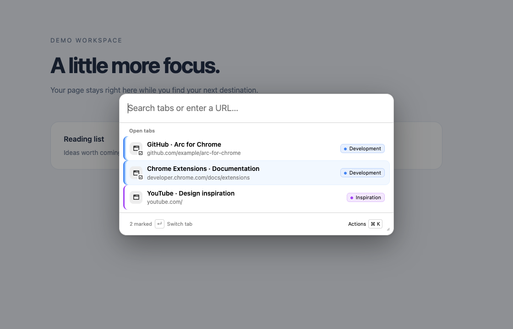 | 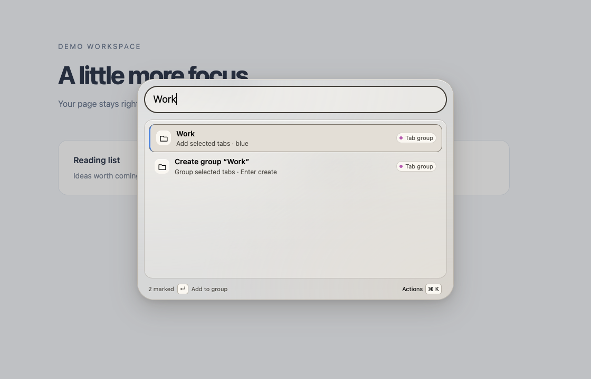 | 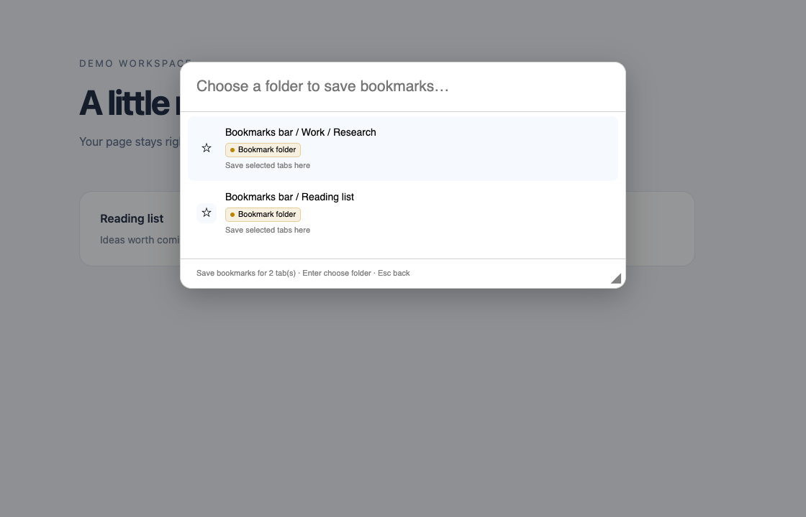 |

### Put tabs in order

Find an open tab in ordinary Search, select it with ↑/↓ and press **Alt/Option+←/→** for horizontal tabs or **Alt/Option+↑/↓** for vertical tabs to move it immediately. Both pairs are available without browser-orientation detection. Add **Shift** to move to the start/end instead (**Alt+Home/End** also works). The overlay stays open and keeps that tab selected. Fast repeat presses are queued without discarded inputs or an empty-list refresh pause; rows animate between positions, respecting reduced-motion preferences.

Type **`@`** to see tabs in their actual strip order; **`@github`** filters that list. Use the same move keys directly. For an exact destination, press Enter on a tab and choose **Move before…**. That explicit placement closes the overlay after applying; Esc returns to tab selection. Commands → Arrange tabs remains available.

Positions are read from the source window in Chrome’s actual tab-strip order. Start/end stays within the same pinned state and group. Moving before another tab requires the same pinned state and group; a one-position move cannot cross their boundary. Movement keys only change order; use the separate group actions below to change membership. Cross-window transfer is not implemented.

### Group tabs without a toolbar

Grouped tabs have a named color badge and matching side stripe in Search and Arrange, with collapsed state noted. Colors identify the native Chrome group; names keep membership readable without relying on color alone.

In Search or `@`, mark tabs with **Shift+Space** or click the square beside a result. Marks survive query changes so you can collect tabs from different searches; at most 100 tabs per operation. Escape in Search clears marks before closing.

| Action | Shortcut inside Spotlight |
| --- | --- |
| Create / add to a group | **Cmd/Ctrl+G** |
| Remove marked tabs from groups | **Cmd/Ctrl+Shift+G** |
| Manage groups | **Cmd/Ctrl+Alt+G** or `> Manage tab groups` |

After **Cmd/Ctrl+G**, type a name and Enter to create a group; an exact existing name is offered first so Enter adds to that group. Choose other matching groups with ↓ and Enter, or select Create explicitly for a duplicate name. **`#Work`** opens the same picker. With no marks, the highlighted open tab is used, or the original page tab when entering through Commands.

Group management supports rename, color, collapse/expand and **Ungroup · Keep all tabs open**. No group action closes tabs. This manages open groups in the source window; it does not offer deletion of saved groups on other devices. Pinned tabs must be unpinned explicitly in Chrome before grouping. The `tabGroups` permission supplies names, colors and group state.

### Bookmarks in a chosen folder

Mark tabs using the same **Shift+Space** or result squares, then:

| Action | Shortcut inside Spotlight |
| --- | --- |
| Save bookmarks | **Cmd/Ctrl+D** |
| Remove bookmarks for selected pages | **Cmd/Ctrl+Shift+D** |

Search for a folder by name or full path, such as `Bookmarks bar / Work / AI`, and press Enter. **`*Work`** opens the save picker. Commands include **Bookmark selected tabs in a folder** and **Remove selected bookmarks from a folder**. With no marks, the highlighted open tab or original source tab is used. Switching save/remove while choosing a folder keeps the same targets.

Saving checks the chosen folder and skips existing URLs without overwriting their titles. Removal lists matching folders and counts; it removes all copies of the selected URLs directly inside that folder. Subfolders, unrelated pages and copies elsewhere are preserved. The palette stays open and reports the result.

Root/managed destinations cannot be modified. Web pages and known Chrome sections are supported; creating folders is outside this mode. Native bookmark changes can sync through Chrome. No new permission: the existing bookmarks grant now also supports these explicit edits. If a browser intercepts a chord, use the prefix or commands.

### Use the browser’s appearance

The overlay follows effective light/dark rendering preferences and uses browser-native colors and scalable type. Custom Chrome wallpaper and profile accents are not imported.

<details>
<summary>Light and dark previews</summary>

| Light | Dark |
| --- | --- |
|  | 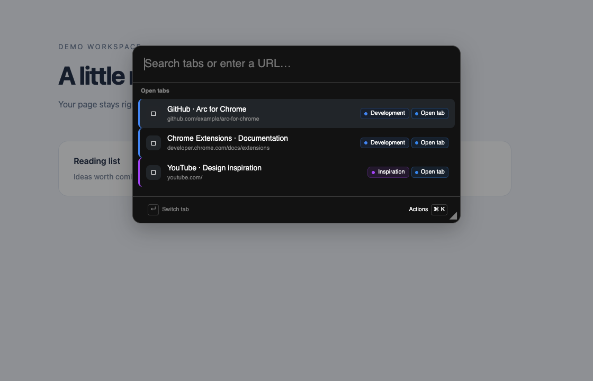 |

</details>

## Built for your browser

Suggestions are processed locally. There is **no telemetry, backend, online autocomplete or persistent content script**. Typed text is not sent to a completion service. Submitting a web or site search contacts the chosen provider normally, just as opening a link contacts its destination.

| Permission | What it enables |
| --- | --- |
| `tabs` | Read tab titles/URLs, activate tabs and perform requested navigation |
| `activeTab`, `scripting` | Show the overlay when invoked |
| `history` | Read local suggestions without editing/deleting history |
| `bookmarks` | Read suggestions and explicitly save/remove selected pages in a chosen folder |
| `search` | Use Chrome’s chosen default provider |
| `sessions` | List and restore recently closed tabs |
| `storage` | Site templates/aliases, local action history, named quicklinks/notes and temporary AI prompt recovery |
| `alarms` | Automatically expire action-history entries |
| `tabGroups` | Read and update source-window group names, colors and state |
| `clipboardWrite` | Copy URLs or calculator results on request; never read the clipboard |
| `favicon` | Read site icons from Chrome’s cache; no external favicon service |

No permanent host access is requested. Automatically inferred site templates are not persisted; ordinary typed text is not saved while composing. Executed action metadata is stored locally with automatic limits; query/prompt text in that journal is opt-in. AI prompt recovery uses separate temporary session storage. [Security policy →](SECURITY.md)

## What to expect

This is a focused command-bar extension, not a complete Arc replacement. It does not provide a sidebar, Spaces, numbered pins, global MRU cycling or a replacement for Chrome’s native tab strip. Arc ranking and every Arc shortcut are not claimed to match exactly.

Suggestions use bounded local samples, so a very old page or an unusual site search format may not be discovered. Restoring a session follows Chrome’s original session destination and may use another window. Full behavior and edge cases are documented in the [user guide](docs/USER_GUIDE.md).

## Build with us

The extension runs on **Manifest V3 + native JavaScript modules** with no runtime packages. **Node.js 22+** is needed only for development checks.

```sh
npm run check          # Syntax checks + behavior tests
npm run check:browser  # Headless Chrome interaction regression
```

The browser check uses a disposable profile and stubbed Chrome APIs. It exercises the real interface without touching your regular profile. Set `CHROME_BINARY` if Chrome is not at the standard macOS path. Actual installed-extension permissions and browser-service integration have a [manual checklist](docs/TESTING.md).

Bug reports, clear reproduction steps and focused pull requests are welcome. See [Contributing](CONTRIBUTING.md) before making changes.

[User guide](docs/USER_GUIDE.md) · [Architecture](docs/ARCHITECTURE.md) · [Testing](docs/TESTING.md) · [Arc behavior audit](docs/ARC_COMMAND_BAR_AUDIT.md) · [Work log](docs/WORK_LOG.md)

---

Interaction patterns also draw inspiration from [Vicinae](https://github.com/vicinaehq/vicinae); all code and bundled visuals here are our own.

[MIT license](LICENSE) · Made for people who miss a good command bar.
