<p align="center">
  
</p>
<h1 align="center">Arc for Chrome</h1>
<p align="center"><strong>Следующая вкладка — на расстоянии одной мысли.</strong><br>Командная строка для Google Chrome, вдохновлённая Arc.</p>
<p align="center">
  <a href="README.md">English</a> · <a href="README.ru.md">Русский</a>
</p>
<p align="center">
  
  
  <a href="LICENSE"></a>
</p>

<p align="center">
  <a href="https://boosty.to/mrfa1n/donate"></a>
</p>

**Текущая версия: 0.24.3.** Добавляет команды для вкладок и окон Chrome, а также режим Vim с хоткеем входа, прокруткой на экран и переходами по заголовкам.

<p align="center">
  <a href="#как-это-работает">Демонстрация</a> · <a href="#установка">Установка</a> · <a href="#привычные-движения">Горячие клавиши</a> · <a href="#ваш-браузер-ваши-данные">Приватность</a> · <a href="#разработка-и-участие">Участие</a>
</p>

Найдите открытую вкладку, вернитесь к закладке, выполните поиск на сайте или команду браузера — прямо поверх текущей страницы. Всё необходимое собрано в одном небольшом окне с управлением с клавиатуры.

**Независимый проект с открытым исходным кодом.** Ранняя MVP-версия; не связана с Arc и The Browser Company. Сейчас проект сосредоточен на поисковой панели. Вкладками, закреплениями и интерфейсом браузера управляет Chrome.

## Как это работает

В Spotlight **живое стекло** подхватывает оттенки открытой страницы. Внутри — поле-капсула, отдельный блок результатов и компактная строка действий с клавишами.

| Светлая тема · тёплый перламутр                                                              | Тёмная тема · графит                                                                     |
| -------------------------------------------------------------------------------------------- | ---------------------------------------------------------------------------------------- |
| 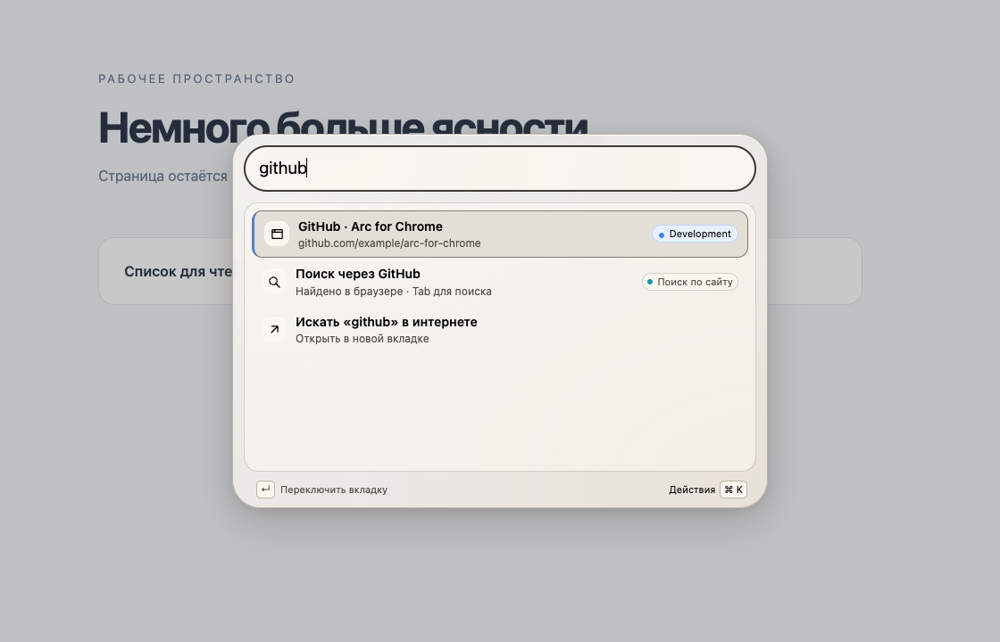 | 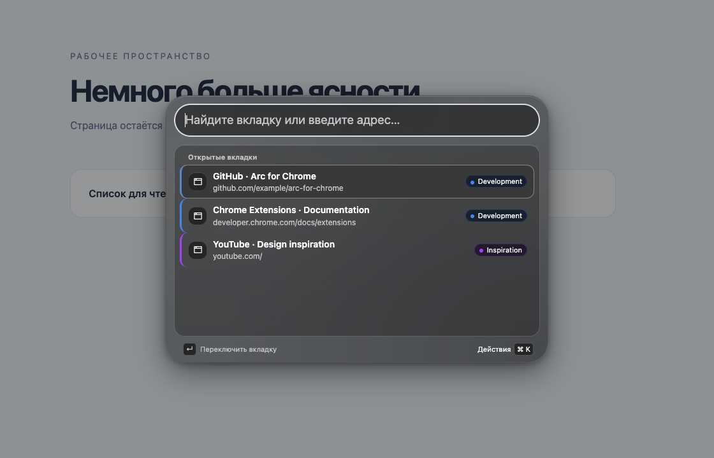 |

_Скриншоты текущего расширения в Chrome с вымышленными вкладками._

<details>
<summary>Демонстрация работы с клавиатуры в текущем оформлении</summary>

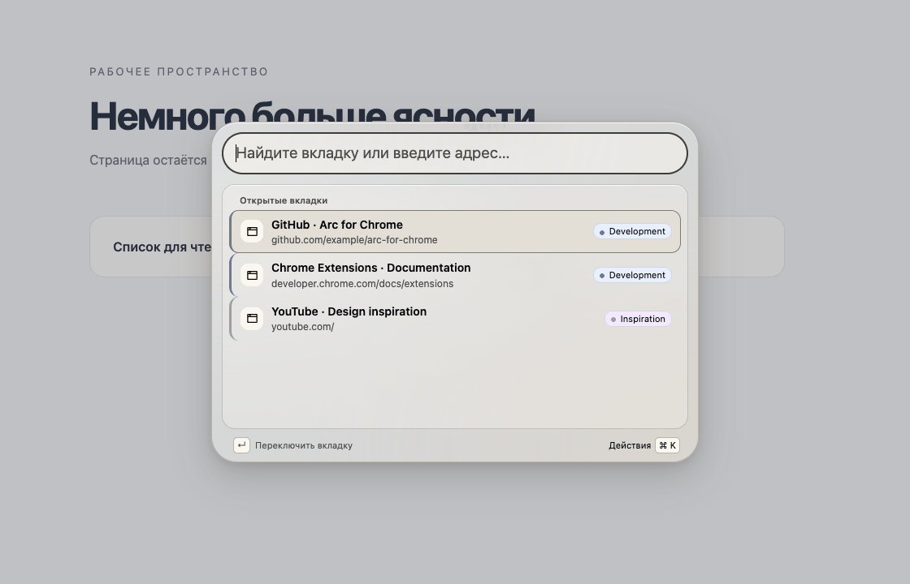

[Как сделана демонстрация](docs/assets/README.md)

</details>

| Найти то, что уже есть                                                                        | Открыть что-то новое                                                                                 |
| --------------------------------------------------------------------------------------------- | ---------------------------------------------------------------------------------------------------- |
| **Открытые вкладки первыми.** Поиск по названию и адресу с переходом на существующую вкладку. | **Ваш поисковик.** Обычные запросы выполняет поисковая система, выбранная в Chrome.                  |
| **Закладки и история.** Сохранённые и посещённые страницы в общих локальных подсказках.       | **Только домен.** Открывайте главную сайта вместо сохранённой внутренней страницы.                   |
| **Недавно закрытые.** Восстановление вкладки через исходную сессию Chrome.                    | **Поиск по сайту.** Автоматическое определение поисковых адресов и запоминание выбранных сокращений. |
| **Понимает неточный ввод.** Английская и русская раскладки, диакритика и небольшие опечатки.  | **Действия браузера.** Перезагрузка, дублирование, копирование адреса, загрузки и другие команды.    |

## Установка

**Chrome 116+ · Без сборки · Без аккаунта · Без дополнительных программ**

1. Скачайте репозиторий через **Code → Download ZIP** и распакуйте архив или клонируйте его.
2. Откройте `chrome://extensions` и включите **Режим разработчика / Developer mode**.
3. Нажмите **Загрузить распакованное расширение / Load unpacked** и выберите папку **`extension`** внутри репозитория.
4. Нажмите иконку расширения или **⌘T** на macOS / **Alt+Shift+K** на Windows и Linux, чтобы открыть поиск поверх текущей страницы. При открытии новой вкладки Chrome также показывает страницу поиска расширения.

Если сочетание открывает обычную вкладку или выполняет другое действие, откройте `chrome://extensions/shortcuts`, найдите **Arc for Chrome** и задайте клавиши для **Open Search**. Панель также можно открыть кликом по иконке расширения. Расширение пока недоступно в Chrome Web Store.

**Обновление:** скачайте новые файлы или выполните pull, затем нажмите **Перезагрузить / Reload** на карточке расширения. Если Chrome запросит новые разрешения, проверьте их и включите расширение снова. Оно использует файлы из `extension` напрямую — отдельная сборка не нужна.

### Язык интерфейса

По умолчанию Spotlight использует язык Chrome с английским в качестве запасного. Чтобы переключить интерфейс, выполните `> настройки`, выберите **English**, **Русский** или **Как в Chrome** в разделе **Язык интерфейса / Interface language** и нажмите **Сохранить язык / Save language**. Откройте Spotlight заново и обновите открытые страницы расширения. Системные подписи на страницах расширений и горячих клавиш Chrome следуют языку самого браузера.

Чтобы добавить перевод, скопируйте `extension/_locales/en/messages.json` в `extension/_locales/<код>/messages.json`, указав [язык, поддерживаемый Chrome](https://developer.chrome.com/docs/extensions/reference/api/i18n#locales). Переведите значения `message`, включая `language_name`, сохраните ключи и заполнители вроде `{0}`. Перезагрузите расширение и откройте настройки. Новый язык появится в списке, а отсутствующие переводы возьмутся из английского файла.

Откройте **Настройки поиска** из Spotlight, чтобы менять параметры прямо в панели. Поле поиска в настройках помогает найти нужный раздел. Esc возвращает к выдаче.

## Привычные движения

В **Настройках поиска → Клавиатура** выберите поле в разделе **Внутри Spotlight** и нажмите новое сочетание. Сохраните изменения и откройте Spotlight заново. Для глобальных сочетаний в том же разделе есть переход в настройки Chrome. Зарезервированные сочетания могут перехватываться браузером или системой.

| Действие                                     | macOS           | Windows / Linux     |
| -------------------------------------------- | --------------- | ------------------- |
| Открыть поиск                                | **⌘T**          | **Alt+Shift+K**     |
| Переключить режим Vim                        | **⌥⇧V**         | **Alt+Shift+V**     |
| Изменить текущий адрес                       | **⌘L**          | **Alt+Shift+L**     |
| Переместить выбранную вкладку влево / вправо | **⌥← / ⌥→**     | **Alt+← / Alt+→**   |
| Переместить в начало / конец                 | **⌥⇧← / ⌥⇧→**   | **Alt+Shift+← / →** |
| Отметить / снять отметку вкладки             | **Shift+Space** | **Shift+Space**     |
| Создать группу / добавить в группу           | **⌘G**          | **Ctrl+G**          |
| Убрать из групп                              | **⌘⇧G**         | **Ctrl+Shift+G**    |
| Управление группами                          | **⌘⌥G**         | **Ctrl+Alt+G**      |
| Сохранить в папку закладок                   | **⌘D**          | **Ctrl+D**          |
| Удалить из папки закладок                    | **⌘⇧D**         | **Ctrl+Shift+D**    |
| Действия выбранного результата               | **⌘K**          | **Ctrl+K**          |
| Выбрать результат                            | **↑ / ↓**       | **↑ / ↓**           |
| Открыть / выполнить                          | **Enter**       | **Enter**           |
| Открыть в фоновой вкладке                    | **Shift+Enter** | **Shift+Enter**     |
| Заменить исходную вкладку                    | **⌥Enter**      | **Alt+Enter**       |
| Принудительно открыть новую активную вкладку | **⌘Enter**      | **Ctrl+Enter**      |
| Выйти из режима / закрыть поиск              | **Esc**         | **Esc**             |

В режиме Search клавиша Enter переключает на открытую вкладку или создаёт новую. В режиме **Edit current URL** она заменяет исходную страницу; неизменённый адрес перезагружает её. Модификаторы навигации действуют на адреса и поисковые запросы; команды и восстановление сессий выполняют своё явно указанное действие.

**Режимы включаются префиксами:** `>` — команды, `@` — порядок вкладок, `<` — недавно закрытые, `?` — восстановление ИИ-промптов, `$` — быстрые ссылки, `:` — заметки. Например, `> настройки` находит команды настроек браузера и расширения, а `> изменить адрес` включает редактирование URL без глобального сочетания. Backspace в пустой строке режима возвращает в обычный поиск.

Эти сочетания действий работают внутри открытого Spotlight. Для вертикальных вкладок используйте **⌥/Alt+↑/↓**, с Shift — начало/конец. **`#Работа`** выбирает группу, **`*Работа`** — папку закладок.

**Команды с целью работают на русском и английском.** Введите `move to Work` или `переместить в Работа`, чтобы выбрать группу вкладок. `pin to Work` или `закрепить в Работа` открывает выбор папки закладок. `pin tab` / `закрепить вкладку` закрепляет саму вкладку Chrome. Для структурных действий используются отмеченные вкладки, а без отметок команда с целью использует текущую вкладку (на странице поиска — последнюю посещённую вкладку этого окна). Нажмите Enter на выбранной цели. Каталог команд также открывается через `/ ` (косая черта и пробел).

**Пространства и раскладка.** `New space` / `создать пространство` работает с группами вкладок Chrome. `switch to space Work` / `перейти в группу Работа` находит группу и переключает на её недавнюю вкладку. `New Split View` / `разделить экран` открывает пустую вторую панель или объединяет две отмеченные соседние вкладки с одинаковой группой и состоянием закрепления. `Close Split View` / `убрать разделение` оставляет обе вкладки открытыми. Для Split View нужен Chrome 155+. `Open sidebar` / `открыть боковую панель` показывает вкладки по группам с поиском. `Manage extensions` / `управление расширениями` открывает настройки расширений Chrome.

### Быстрые действия из Arc для macOS

- **Предыдущая вкладка** возвращает на последнюю использованную вкладку окна. Предлагаемое сочетание — **⌥⇧Q** на Mac и **Alt+Shift+Q** на Windows/Linux. Назначение можно изменить в настройках сочетаний Chrome.
- В **⌘K → Copy links from selected tabs** можно скопировать ссылки отмеченных вкладок списком. **Copy links as Markdown** добавляет заголовки.
- **Hide this suggestion** скрывает подсказку из истории, закладок или адресов главных страниц. **Restore hidden suggestions** сбрасывает список. Открытые вкладки остаются в поиске.
- **Paste and go** читает буфер только после выбора действия. Если Chrome отклонит чтение, панель попросит вставить адрес вручную. **Open first web result via DuckDuckGo** отправляет текущий запрос этому поисковику только после выбора действия. Shift+Enter по-прежнему открывает в фоне.
- Поиск из сгруппированной вкладки показывает открытые вкладки этой группы. **Switch group / window search** (каталог или ⌘K) меняет область вкладок. Закладки и история остаются доступны. Новые страницы по умолчанию открываются в активной группе. **Route this domain to a group** привязывает домен к группе с уникальным именем в окне. **Clear route for this domain** снимает правило.
- **Open temporary preview** открывает ссылку в компактном окне. Из его каталога команд выберите **Keep preview as tab** или **Keep preview in Split View**, чтобы перенести её в исходное окно. Split требует Chrome 155+ и незакреплённую исходную вкладку вне группы. Закрыть предпросмотр можно обычным **⌘W**.

**У Tab три полезных применения:**

- В пустой строке Search — перейти в **Commands**. Символ `>` также включает команды.
- После названия или сокращения найденного сайта — включить **Site Search**.
- На выбранном результате с адресом — подставить адрес для редактирования без перехода.

Если подходят несколько сайтов, выберите нужный стрелками. Повторное нажатие сочетания поиска закрывает панель. [Подробное руководство по клавишам, EN →](docs/KEYBOARD_REMAPPING.md)

## Больше возможностей в одной строке

Результаты стали компактнее: название и адрес слева, цветные метки источников и групп справа. Иконки сайтов берутся из кэша Chrome отдельно от поиска; если иконки нет, остаётся обычный символ. При пустом запросе видны секции открытых вкладок, быстрых ссылок, недавних действий и частых команд. Недавнее действие открывает журнал, не повторяя операцию. Частота команд определяется по уже существующему ограниченному журналу; без него показываются начальные команды.

### Действия без заучивания хоткеев

Выберите результат и нажмите **⌘/Ctrl+K** или кнопку **Actions** внизу. Введите название действия и нажмите Enter. Меню показывает подходящие операции: открыть в новой/фоновой вкладке, скопировать URL или вычисление, переместить/дублировать вкладку, объединить отмеченные вкладки, изменить закладки в папке, сохранить/изменить быструю ссылку или перенаправить запрос. Прямые хоткеи продолжают работать. **Esc** или повторный вызов действий возвращает исходный запрос и выбор. Внизу показывается основное действие с клавишей в отдельной плашке; Tab/Shift+Tab позволяют перейти к Actions и углу изменения размера.

### Тот же запрос — другой поисковик

В общей выдаче есть одно действие веб-поиска через поисковик Chrome по умолчанию. Все провайдеры и обнаруженные поиски по сайтам доступны через **Actions → Search this query with…**. Введите имя сервиса: фильтр не меняет сам промпт. При перенаправлении распознанный префикс предыдущего провайдера убирается. Esc возвращает исходный запрос. Отправка происходит только по Enter; перед переходом к ИИ сохраняется прежняя резервная копия запроса.

### Именованные быстрые ссылки

Выберите веб-страницу → **Actions → Save as quicklink…** → введите имя → Enter. Затем ищите её по имени/адресу в обычном поиске или введите **`$`** / **`$работа`** для списка/фильтра быстрых ссылок. Также доступна команда **Manage quicklinks**. Через Actions ссылку можно переименовать или удалить. Команда **Save selected page as quicklink** сохраняет текущую страницу из режима команд.

Быстрые ссылки хранятся локально в этом профиле Chrome отдельно от закладок: максимум **100**, имя **1–80 символов**, адрес HTTP(S) без встроенного логина/пароля. Они остаются до явного удаления; очистка журнала действий их не удаляет. Автоматической синхронизации нет.

### Заметки и все сочетания клавиш

Откройте **⌘/Ctrl+K → New note**. Введите заголовок, через Tab перейдите к многострочному тексту и сохраните через **⌘/Ctrl+Enter** или **Save note**. Обычный Enter в тексте добавляет строку. Заметки ищутся по заголовку и содержимому в обычном поиске, через **`:запрос`** или **Actions → Search / manage notes**. В Actions выбранной заметки есть редактирование, копирование текста и удаление. Esc отменяет несохранённые изменения; повторное открытие возвращает сохранённый текст. Автосохранения нет. Лимиты: **200 заметок**, **80 символов в заголовке**, **20 000 в тексте**. Заметки локальны для этого профиля, не зависят от очистки журнала и автоматически не синхронизируются. Если заметку изменили в другом окне, старая версия не перезапишет новую; при ошибке сохранения введённый текст остаётся в редакторе. Текст заметок в журнал действий не записывается.

В том же меню **⌘/Ctrl+K** теперь перечислены **все сочетания и префиксы расширения**: отметки вкладок, перемещение по обеим осям и к краям, группы/закладки, подстановка/фокус, положение и размер Spotlight, сохранение заметки. Контекстные команды выполняются как раньше; строки с меткой **Shortcut** служат справкой, объясняют нужный режим, а **Enter копирует инструкцию**. **All keyboard shortcuts** открывает полный справочник с поиском. Для глобального поиска и редактирования URL показываются реальные назначения Chrome, в том числе изменённые или неназначенные. Если прочитать их не удалось, интерфейс предлагает проверить настройки, а не угадывает сочетание. Заметки и справка доступны и когда в поиске нет результатов.

| Многострочные заметки                                                                       | Все сочетания клавиш                                                                                |
| ------------------------------------------------------------------------------------------- | --------------------------------------------------------------------------------------------------- |
| 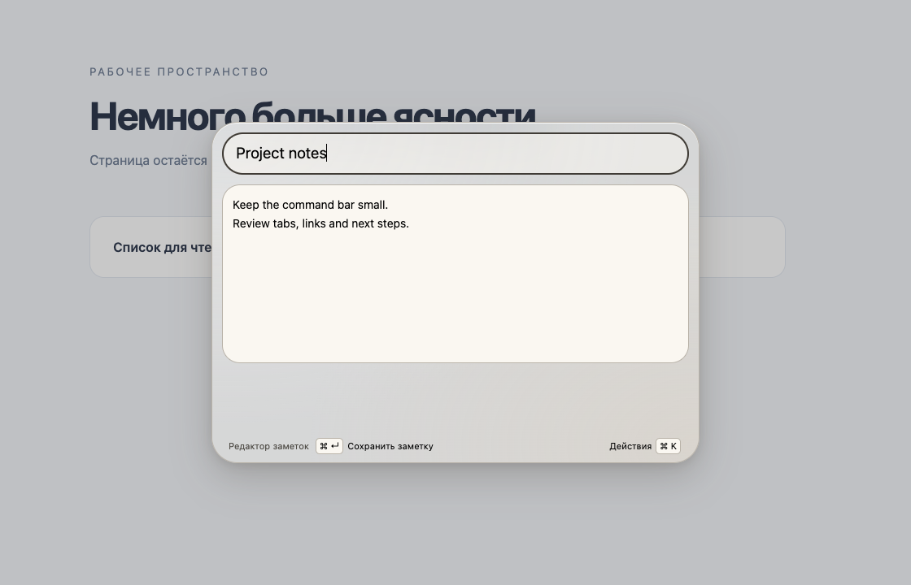 | 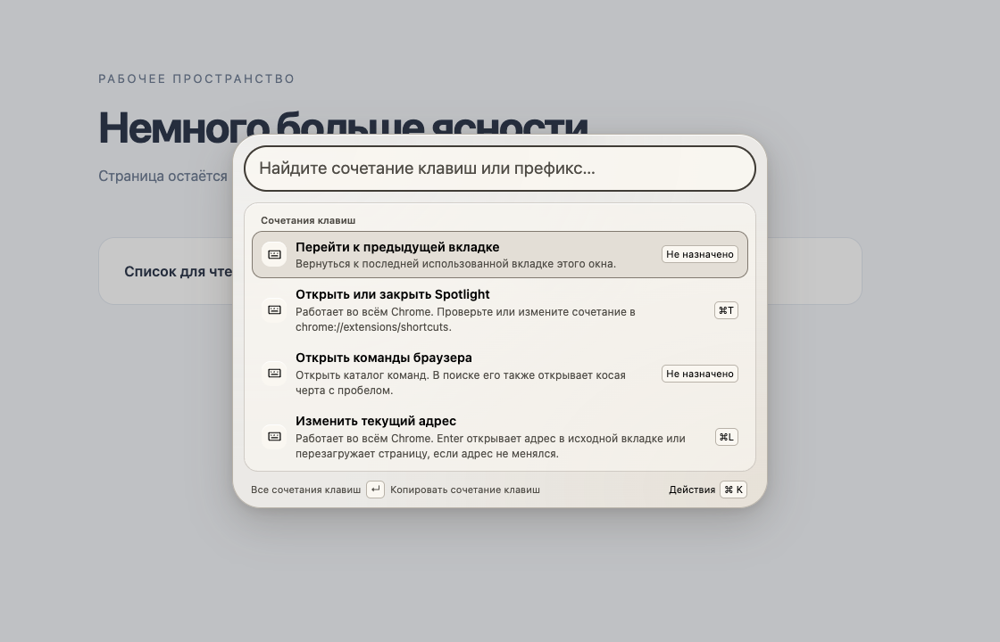 |

[Посмотреть список заметок](docs/assets/spotlight-notes.ru.png). В демонстрации вымышленные заметки и назначения клавиш.

### Калькулятор поверх страницы

Введите **`1250 * 0.18`** → **225** → Enter скопирует результат, оставив Spotlight открытым. Поддерживаются скобки, `+ - * / ^ %`, унарные знаки и `× ÷ −`; `%` — остаток от деления. Степени вычисляются справа налево. Вычисления выполняются локальным ограниченным парсером без `eval`, округляются до 12 значащих цифр; конвертации валют, дат и единиц пока нет. Некорректное выражение остаётся обычным поисковым запросом. История вычислений не сохраняется.

| Действия выбранного результата                                               | Выбор поисковика                                                             |
| ---------------------------------------------------------------------------- | ---------------------------------------------------------------------------- |
| 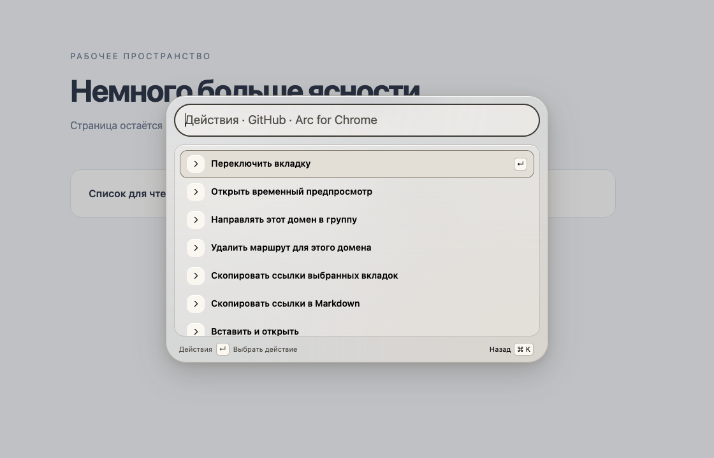 | 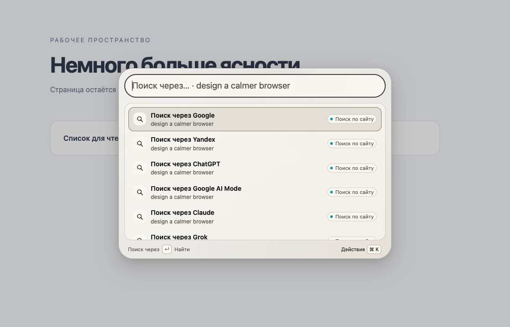 |

| Локальный калькулятор                                                            | Быстрые ссылки                                                           |
| -------------------------------------------------------------------------------- | ------------------------------------------------------------------------ |
| 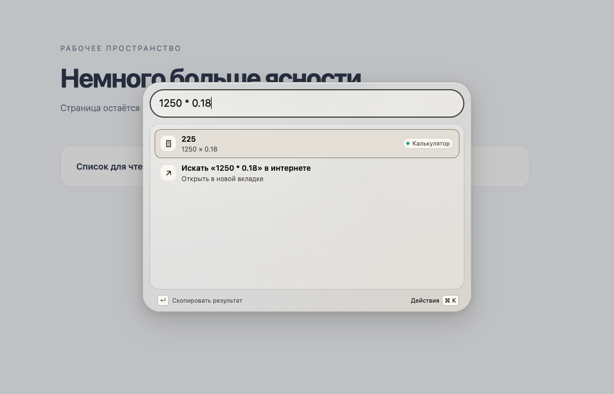 | 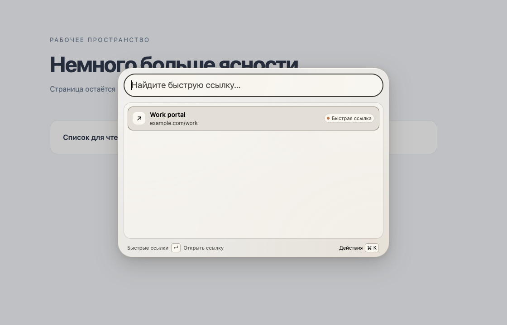 |

## Поиск, который не мешает

### Перемещайте окно поиска

Потяните за нижнюю строку подсказок, чтобы переместить Spotlight в пределах страницы браузера. **Ctrl+Alt+стрелки** двигают его на 16 пикселей, с **Shift** — на 64. **Ctrl+Alt+0** возвращает исходное положение. Эти сочетания работают только внутри открытого Spotlight; ⌥/Alt+←/→ по-прежнему перемещает вкладки. При изменении размеров окна или списка результатов поиск остаётся видимым. При следующем открытии позиция сбрасывается. На защищённых страницах перетаскивайте отдельное окно поиска за его заголовок.

### Настройте размер

Потяните за правый нижний угол Spotlight. Зона перетаскивания работает без видимого значка. Размер панели — от **360×220 до 1000×800 пикселей** в пределах доступного окна. Из поля поиска нажмите **Shift+Tab**, чтобы перейти к уголку, затем используйте стрелки для изменения размера. **Shift** увеличивает шаг, **Enter** сбрасывает размер. **Ctrl+Alt+0** сбрасывает размер и положение. Выдача прокручивается внутри панели. При навигации стрелками у выбранной строки сохраняется отступ от краёв, а над первой строкой секции виден её заголовок.

### Оставайтесь на своей странице

Текущая страница остаётся под панелью. Пока вы печатаете, сочетания страницы и видео не срабатывают. При закрытии фокус возвращается на страницу. На защищённых страницах вроде `chrome://settings` расширение открывает отдельное компактное окно поиска, привязанное к исходной вкладке.

### Сокращения появляются сами

Выполните поиск на сайте и заново откройте панель. Если его поисковый адрес распознан среди вкладок, недавних закладок или истории, сайт станет доступен как отдельная область поиска. Введите название или сокращение, нажмите **Tab**, введите запрос и нажмите **Enter**.

Встроенные сокращения работают с первого запуска. Например, **`ютуб` → Tab → `дизайн интерфейсов` → Enter** откроет выдачу YouTube. Так же работают `рутуб`, `кинопоиск`, `имдб`, `стим`, `вики`, `гитхаб`, `npm`, `mdn`, `реддит`, `озон`, `авито`, `карты` и `хх`. Полный список есть в **Настройки поиска → Поисковые сокращения**. Когда вы подтверждаете введённое сокращение выбором сайта, расширение сохраняет эту связь локально и повышает её приоритет при следующем использовании.

Откройте `> Search settings`, чтобы посмотреть найденные сайты или добавить шаблон адреса вручную. Чтобы удалить ручные шаблоны, нажмите **Clear overrides**, затем **Save changes**. Автоопределение работает по ограниченной выборке недавних данных и известным форматам запроса. Оно не придумывает поисковые адреса и не читает внутренние настройки Site Search в Chrome.

Для музыки доступны **`Яндекс Музыка`** (или `ямузыка`), **`YouTube Music`**, `spotify`, `soundcloud`, `apple music`, `bandcamp`, `deezer` и `last.fm`. Введите название, нажмите Tab, затем введите исполнителя или трек и нажмите Enter.

### Сокращение + запрос, в том числе к ИИ

Введите сокращение, пробел и запрос, затем Enter — без отдельного Tab:

| Пример                                   | Куда отправится запрос           |
| ---------------------------------------- | -------------------------------- |
| `g расширения браузера`                  | Google                           |
| `ya погода завтра` или `я погода завтра` | Яндекс                           |
| `gpt объясни замыкания`                  | ChatGPT                          |
| `gem объясни замыкания`                  | Google AI Mode — диалог в поиске |
| `claude оцени эту идею`                  | Claude                           |
| `grok объясни эту тему`                  | Grok                             |
| `pplx сравни варианты`                   | Perplexity                       |

Эти сервисы доступны сразу. Точные известные и запомненные сокращения других сайтов тоже работают: например, `yt design` для YouTube. В первом результате видно получателя. Неизвестное сокращение остаётся обычным поиском; при одинаковом приоритете нескольких сайтов нужный выбирается стрелкой ↓. Сокращение + Tab продолжает работать. Ручные настройки могут переопределять встроенные адреса и сокращения.

Промпт передаётся через веб-адрес сервиса, без API-ключей, выбора модели, дополнительных программ и внедрения скриптов в чат. Авторизация, подстановка текста и окончательная отправка зависят от сервиса. Ссылки Claude/Grok и передачу промптов в авторизованном профиле ещё нужно проверить вручную; автоматическая отправка не гарантируется.

### Если страница не загрузилась — восстановите промпт

Перед открытием ИИ-сервиса Spotlight сохраняет копию запроса в памяти сеанса. Введите **`?`**, выберите запрос и нажмите Enter: текст вернётся в строку без повторной отправки. Выделится только сокращение сервиса — замените его, чтобы перенаправить тот же промпт, или нажмите Enter для повтора. Также доступны **`> Recover AI prompts`** и очистка через **`> Clear saved AI prompts`**.

Хранятся до 20 промптов, доступных 24 часа в пределах текущего сеанса. Перезапуск браузера, перезагрузка, обновление или отключение расширения удаляют эти копии. Автоматического определения ошибок загрузки и повторной отправки нет. Если копию сохранить не удалось, переход к ИИ останавливается с сообщением об ошибке.

### История действий Spotlight

[Посмотреть страницу истории](docs/assets/spotlight-activity.ru.png).

Откройте **`> Spotlight activity history`** (можно найти словами «история spotlight») или ссылку в Search settings. Здесь можно посмотреть успешные и неудачные действия, искать по журналу и настроить автоочистку. По умолчанию: **7 дней, максимум 500 записей**, без текста запросов и промптов. Запись можно отключить, хранение текста — включить отдельно, срок и количество — изменить, историю — очистить вручную. Отключение записи текста не удаляет уже сохранённый текст; для этого очистите журнал.

История хранится только на устройстве. Chrome автоматически удаляет просроченные записи, пока браузер запущен; лимиты также проверяются при действиях и открытии журнала. Максимальный настраиваемый лимит — 5000 записей. Срок 0 часов отключает удаление по возрасту, но ограничение количества сохраняется. Статус означает выполнение операции Chrome, а не успешную загрузку сайта или ответ ИИ. Временные копии промптов отделены от журнала и настройки записи текста.

### Локальное обучение

Обучение включено по умолчанию при включённой записи действий.

Введите **`> настройки`**, выберите **Настройки поиска** и нажмите Enter. В разделе **Настройки Spotlight** измените параметр **Учиться на моих выборах** и нажмите **Сохранить изменения**. Чтобы сбросить предпочтения, откройте **Историю действий Spotlight** и нажмите **Очистить историю**. Это удалит весь журнал.

Spotlight учитывает недавние выборы при сортировке совпадений в режиме команд и предлагает ИИ-сервис для похожих запросов. Например, после `claude explain closures` запрос `объясни замыкания` может показать отдельную подсказку Claude. Явные сокращения сохраняют приоритет. Восстановление промптов ищет похожие черновики на русском и английском и может предложить другой сервис. Выбор черновика возвращает текст в строку для редактирования.

Обучение использует небольшой встроенный словарь тем. Векторы тем, выбор команд и запуск сервисов остаются в локальном журнале и подчиняются его сроку хранения. Запись исходного текста в журнал управляется отдельной настройкой. Оценка сервиса учитывает результат операции открытия в Chrome. Очистка журнала сбрасывает предпочтения. Для нормализации векторов используется WebNN, когда он доступен, и JavaScript в остальных случаях.

### Найдите страницу или просто откройте сайт

Для сохранённого `example.com/articles/some-page` поиск может предложить саму страницу и отдельное действие **Open example.com**. Открытые вкладки исходного окна остаются первыми. Одинаковые адреса объединяются, чтобы история и закладки не создавали дубликаты.

### Ищите разделы самого Chrome

Введите **«расширения»**, **«настройки»**, **«пароли»**, **«закладки»** или английское название прямо в обычном поиске. Разделы помечены **Chrome page**. Enter открывает выбранный раздел; если он уже открыт в исходном окне, поиск предлагает перейти на эту вкладку. Tab подставляет внутренний адрес для редактирования.

В каталоге есть расширения и их сочетания клавиш, настройки браузера, история, загрузки, закладки, менеджер паролей, конфиденциальность и безопасность, разрешения сайтов, оформление, поисковые системы, языки, специальные возможности, производительность, запуск, браузер по умолчанию, автозаполнение, сведения о Chrome, версия и список внутренних страниц. Они доступны и в Commands. **Open Chrome settings** открывает настройки браузера; **Search settings** — настройки нашего расширения.

Адрес из каталога, например `chrome://extensions`, можно ввести напрямую. Распознаются только перечисленные внутренние адреса. Расширение открывает разделы, не читая их приватное содержимое и не меняя настройки автоматически. Дополнительные разрешения не нужны.

Цветные подписи показывают источник: **синий — открытая вкладка**, **янтарный — закладка**, **фиолетовый — история**, **зелёный — главная сайта**, **бирюзовый — поиск по сайту**, **оранжевый — восстановление сессии**, **серый — разделы Chrome и команды**. У объединённого результата видны все источники. Цвета групп вкладок показываются отдельно. Текстовые подписи доступны в светлой и тёмной теме и позволяют различать категории без опоры на цвет.

Отдельные метки есть и у сохранённых ИИ-запросов, папок закладок, действий с группами, выбора позиции вкладки и открытия/поиска. Папки используют цвет закладок, действия с группами — отдельную розово-лиловую метку.

### Один выбор — разные действия

1. Найдите вкладки в поиске или `@`, отметьте нужные через **Shift+Space**. Отметки сохраняются при смене запроса.
2. Нажмите **⌘/Ctrl+G**, введите имя группы и Enter для создания или выберите существующую группу.
3. Или нажмите **⌘/Ctrl+D**, найдите папку по имени/пути и Enter для сохранения этих страниц. **⌘/Ctrl+Shift+D** удаляет их закладки из выбранной папки.

| Выберите вкладки                                                                     | Выберите группу                                                              | Выберите папку закладок                                                    |
| ------------------------------------------------------------------------------------ | ---------------------------------------------------------------------------- | -------------------------------------------------------------------------- |
| 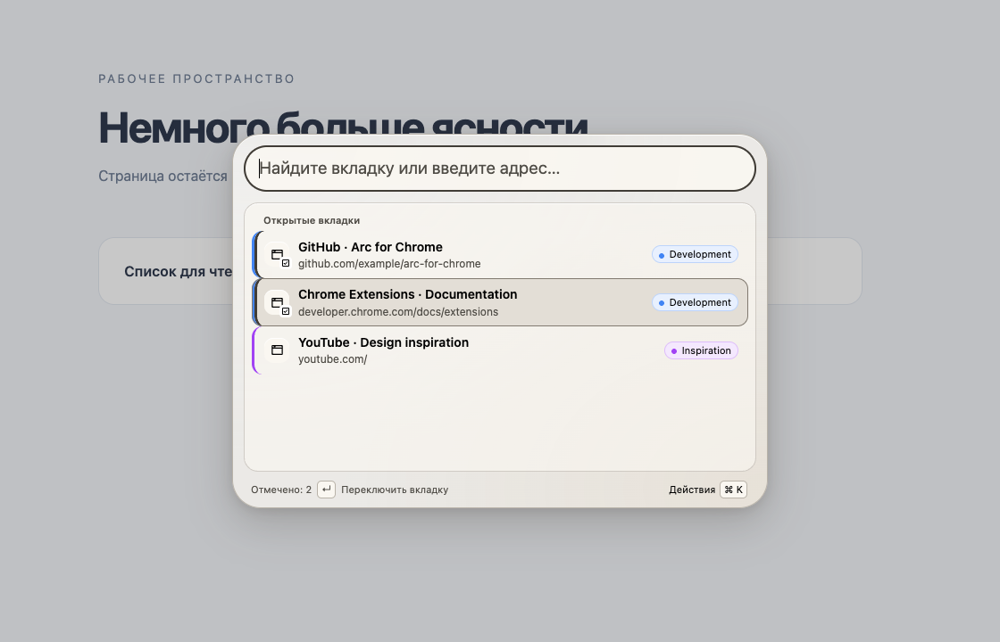 | 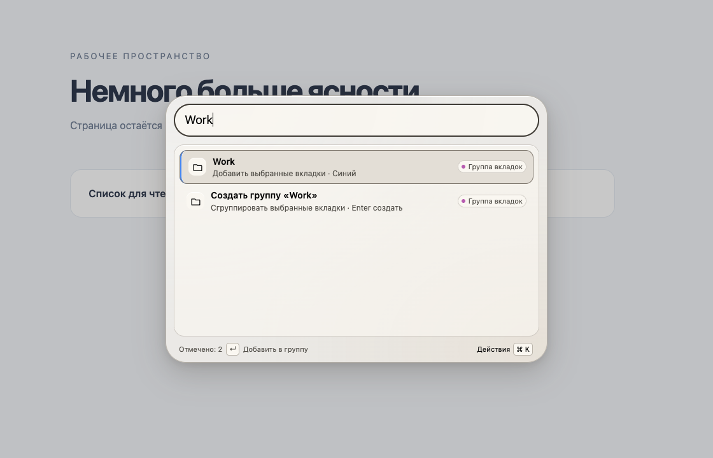 | 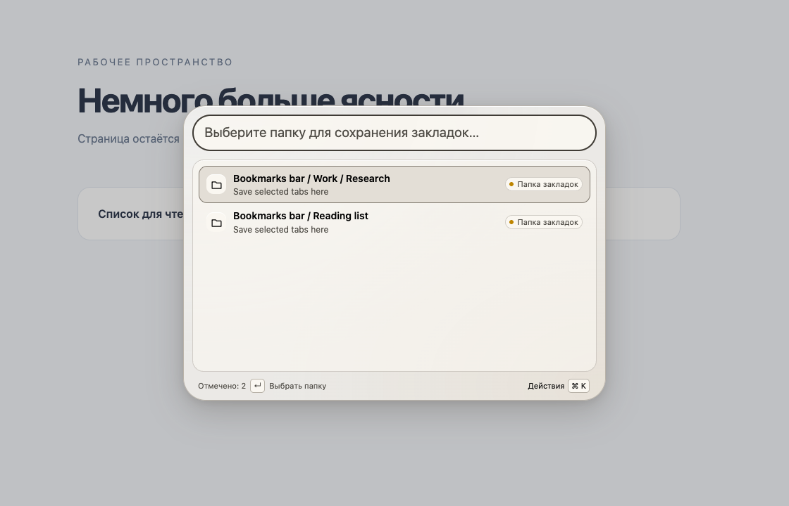 |

### Наведите порядок во вкладках

Найдите открытую вкладку в обычном поиске, выделите её стрелками ↑/↓ и нажмите **⌥/Alt+←/→** для горизонтальных вкладок или **⌥/Alt+↑/↓** для вертикальных — вкладка сразу сдвинется. Обе пары работают без определения ориентации браузера. Добавьте **Shift**, чтобы переместить в начало или конец; также работают **Alt+Home/End**. Панель остаётся открытой и сохраняет выделение на той же вкладке. Быстрые повторные нажатия выполняются очередью без пропусков и паузы очистки списка; строки плавно меняют положение. Настройка уменьшения движения отключает анимацию.

Введите **`@`**, чтобы увидеть вкладки в их текущем порядке; **`@github`** отфильтрует список. Те же сочетания перемещают выбранную вкладку сразу. Для точного размещения нажмите Enter на вкладке и выберите **Move before…** — перед другой вкладкой. После этого действия панель закроется; Esc возвращает к выбору вкладки. Команда Arrange tabs также доступна через `>` и запрос «порядок».

Позиции соответствуют реальному порядку вкладок исходного окна Chrome. Начало/конец — в пределах того же состояния закрепления и той же группы. Переместить перед другой вкладкой можно в этих же пределах; сдвиг на одну позицию не пересекает их границы. Клавиши перемещения меняют только порядок; для переноса между группами используйте отдельные действия ниже. Перенос между окнами пока не реализован.

### Группы вкладок без лишних окон

У вкладок в группах показываются цветная подпись с названием и полоса того же цвета сбоку — в поиске и в `@`. Для свёрнутых групп есть отметка состояния. Название позволяет различать группы не только по цвету.

В поиске или списке `@` отмечайте нужные вкладки **Shift+Space** или нажатием на квадрат слева от результата. Отметки сохраняются при смене запроса; можно собрать вкладки из разных результатов поиска. Лимит — 100 вкладок за операцию. Esc в обычном поиске сначала снимает отметки.

| Действие                                 | Сочетание внутри Spotlight                 |
| ---------------------------------------- | ------------------------------------------ |
| Создать группу / добавить в существующую | **⌘/Ctrl+G**                               |
| Убрать отмеченные вкладки из групп       | **⌘/Ctrl+Shift+G**                         |
| Управлять группами                       | **⌘/Ctrl+Alt+G** или `> Manage tab groups` |

После **⌘/Ctrl+G** введите название и нажмите Enter для новой группы; если группа с точным именем уже есть, она предлагается первой и Enter добавит вкладки в неё. Другие совпадения выбираются стрелкой ↓; новую группу с тем же именем можно создать отдельным результатом Create. Префикс **`#Работа`** открывает тот же выбор. Если ничего не отмечено, используется выделенная открытая вкладка, а в командах — исходная вкладка страницы.

В управлении группой доступны переименование, цвет, сворачивание/разворачивание и **Ungroup · Keep all tabs open** — разгруппировать, сохранив вкладки открытыми. Операции не закрывают вкладки. Это управление открытыми группами текущего окна. Отдельной команды удаления сохранённой группы нет; синхронизацией изменений управляет Chrome. Закреплённые вкладки сначала нужно открепить в Chrome; расширение не делает это автоматически. Новое разрешение `tabGroups` используется для названий, цветов и состояния групп.

### Закладки в выбранной папке

Отметьте вкладки тем же **Shift+Space** или квадратами, затем:

| Действие                           | Сочетание внутри Spotlight |
| ---------------------------------- | -------------------------- |
| Сохранить в закладки               | **⌘/Ctrl+D**               |
| Удалить закладки выбранных страниц | **⌘/Ctrl+Shift+D**         |

Выберите папку по названию или полному пути, например `Панель закладок / Работа / AI`, и нажмите Enter. **`*Работа`** открывает выбор папки для сохранения; через `>` доступны **Bookmark selected tabs in a folder** и **Remove selected bookmarks from a folder**. Если ничего не отмечено, используется выделенная открытая или исходная вкладка. При переключении добавления/удаления внутри выбора папки набор вкладок сохраняется.

Повторное добавление проверяет адреса в выбранной папке и пропускает уже сохранённые, сохраняя их названия. Удаление показывает только подходящие папки и число совпадающих закладок; удаляются все копии выбранных адресов непосредственно в этой папке. Вложенные папки, другие страницы и копии в других папках остаются. После операции Spotlight остаётся открытым и показывает результат.

Корень и управляемые организацией папки недоступны для изменений. Поддерживаются веб-страницы и известные разделы Chrome; создание новых папок не входит в этот режим. Изменения обычных закладок могут синхронизироваться самим Chrome. Новых разрешений нет — используется уже имеющееся `bookmarks`. Если браузер перехватывает сочетание, используйте `*` или команды.

При первом открытии Spotlight предложит короткое интерактивное знакомство. Можно потренироваться искать вкладку, открывать команды и пользоваться `/all`. Чтобы повторить знакомство, выберите **Настройки поиска → Настройки Spotlight → Показать знакомство со Spotlight снова** и снова откройте панель.

### Поиск по всем окнам и отмена действий

Введите **`/all`** в обычном поиске, чтобы найти открытые вкладки во всех окнах того же режима просмотра. Выдача показывает номер окна и группу вкладки, если она есть. Нажмите Enter, чтобы переключиться на результат. Обычный поиск по-прежнему работает в текущем окне.

После перемещения вкладки в Spotlight или добавления вкладок в существующую группу нажмите **Отменить** в панели. Последнее действие можно отменить в течение минуты, пока фоновый процесс хранит его и состав, порядок и группы вкладок не изменились. Если исходная группа исчезла, отмена недоступна.

В **Настройках поиска → Настройки Spotlight** можно включить **Плотное стекло** и изменить настройку **Учиться на моих выборах**. Для обучения должна быть включена запись действий.

### Навигация по странице в стиле Vim

На веб-странице нажмите **Option+Shift+V** на macOS или **Alt+Shift+V** на Windows и Linux. Если Chrome не назначил сочетание, задайте его в `chrome://extensions/shortcuts` → **Arc for Chrome** → **Переключить режим навигации по странице**. Там же можно назначить хоткей открытия каталога команд. Чтобы войти сразу, введите `> навигация по странице` в Spotlight, выберите команду и нажмите Enter. Режим изначально выключен, включается на текущей веб-странице и показывает индикатор.

- **j / k** прокручивают вниз и вверх, **h / l** — влево и вправо.
- **d / u** пролистывают на пол-экрана вниз и вверх, **Home** или **gg** переносят в начало страницы, **End** или **Shift+G** — в конец.
- **[ / ]**, **Page Up / Page Down** или **Ctrl+B / Ctrl+F** листают на экран вверх и вниз. **Ctrl+U / Ctrl+D** листают на пол-экрана. Chrome или система могут перехватить отдельные сочетания с Ctrl.
- **{ / }** переходят к предыдущему или следующему заголовку. **0 / $** переносят к левому или правому краю прокручиваемой по горизонтали области.
- **Esc** или повторное нажатие хоткея выключает режим. При уходе со страницы он тоже выключается. В полях ввода клавиши работают как обычно. Chrome ограничивает внедрение скриптов на защищённых страницах.

### Управление вкладками, окнами и профилем

Введите `>` и найдите нужную команду. Можно создать или закрыть текущую вкладку, переключаться по порядку вкладок, вынести вкладку в новое окно, перейти назад или вперёд, обновить страницу без кэша или изменить масштаб. Команды окон переключают окна текущего профиля, сворачивают и разворачивают их и меняют полноэкранный режим. Команда **Новое окно инкогнито** открывает приватное окно, если Chrome это разрешает.

Команда **Открыть настройки текущего профиля Chrome** открывает настройки профиля. Для перехода в другой профиль используйте меню профиля Chrome рядом с адресной строкой. Команда переключения окон Spotlight работает внутри текущего профиля и режима просмотра.

### Живое стекло в обеих темах

Spotlight следует активной светлой или тёмной теме Chrome. Светлая тема — тёплый перламутр, тёмная — графит. На обычных сайтах Chrome размывает страницу в пределах контура палитры. Полупрозрачные панель и выдача пропускают оттенки страницы, когда вы перемещаете палитру; поле поиска и выбранная строка остаются плотнее, чтобы текст хорошо читался.

На новой вкладке и в отдельном окне поиска для защищённых страниц используется фон расширения. Если Chrome сообщает об уменьшенной прозрачности, повышенном контрасте или принудительных цветах, Spotlight использует непрозрачные системные поверхности. [Дизайн-система и токены](docs/DESIGN_SYSTEM.md)

## Ваш браузер, ваши данные

Подсказки обрабатываются локально. **Нет телеметрии, сервера, сетевого автодополнения и постоянно работающих скриптов на страницах.** Вводимый текст не отправляется сервису подсказок. Отправка поискового запроса обращается к выбранному поисковику или сайту обычным образом, как открытие ссылки — к её адресу.

| Разрешение               | Для чего используется                                                                                          |
| ------------------------ | -------------------------------------------------------------------------------------------------------------- |
| `tabs`                   | Чтение названий и адресов вкладок, переключение и запрошенные переходы                                         |
| `activeTab`, `scripting` | Показ панели при вызове                                                                                        |
| `history`                | Чтение истории для подсказок, без изменения или удаления                                                       |
| `bookmarks`              | Подсказки и явное добавление/удаление выбранных страниц в выбранной папке                                      |
| `search`                 | Поиск через выбранного в Chrome провайдера                                                                     |
| `sessions`               | Список и восстановление недавно закрытых вкладок                                                               |
| `storage`                | Шаблоны и сокращения, локальный журнал действий, быстрые ссылки/заметки и временное восстановление ИИ-промптов |
| `alarms`                 | Автоматическая очистка истории действий по сроку                                                               |
| `tabGroups`              | Названия, цвета и состояние групп текущего окна                                                                |
| `clipboardWrite`         | Запись в буфер по явной команде. Действие **Paste and go** отдельно читает буфер при выборе.                   |
| `sidePanel`              | Открытие списка вкладок через **Open sidebar**                                                                 |
| `favicon`                | Иконки из кэша Chrome без стороннего сервиса                                                                   |

Постоянный доступ к сайтам не запрашивается. Автоматически найденные шаблоны не сохраняются между вызовами; вводимый текст не сохраняется во время набора. Метаданные выполненных действий хранятся локально с автоочисткой; сохранение текста запросов в журнале включается отдельно. Для восстановления ИИ-промптов используется временное хранилище сеанса. [Политика безопасности, EN →](SECURITY.md)

## Текущие возможности и границы

Проект дополняет штатную полосу вкладок Chrome. Команда **`> Open sidebar`** открывает боковую панель со списком вкладок и поиском. Команда **New space** создаёт обычную группу вкладок Chrome. Пронумерованные закрепления и глобальное циклическое переключение по последней активности отсутствуют.

Поиск использует ограниченные локальные выборки: очень старая страница или нестандартный поисковый формат могут не определиться. Восстановление сессии следует исходному назначению Chrome и может открыть вкладку в другом окне. Подробные правила и пограничные случаи описаны в [руководстве пользователя, EN](docs/USER_GUIDE.md).

## Разработка и участие

Расширение использует **Manifest V3 и нативные JavaScript-модули**, без пакетов для работы в браузере. **Node.js 22+** нужен только для проверок при разработке.

```sh
npm run check          # Проверка синтаксиса и тесты поведения
npm run check:browser  # Проверка интерфейса в headless Chrome
```

Браузерная проверка использует временный профиль и заглушки Chrome API. Проверяется настоящий интерфейс, а ваш обычный профиль не затрагивается. Укажите `CHROME_BINARY`, если Chrome установлен не по стандартному пути macOS. Для разрешений установленного расширения и реальных сервисов браузера есть [ручной чек-лист, EN](docs/TESTING.md).

Приветствуются сообщения об ошибках с шагами воспроизведения и небольшие целевые pull request. Перед изменениями прочитайте [Contributing, EN](CONTRIBUTING.md).

[Руководство](docs/USER_GUIDE.md) · [Архитектура](docs/ARCHITECTURE.md) · [Тестирование](docs/TESTING.md) · [Аудит поведения Arc](docs/ARC_COMMAND_BAR_AUDIT.md) · [Журнал работ](docs/WORK_LOG.md)

---

Взаимодействия также вдохновлены [Vicinae](https://github.com/vicinaehq/vicinae); код и включённые изображения реализованы в этом проекте самостоятельно.

[Лицензия MIT](LICENSE) · Для тех, кому не хватает удобной командной строки.
